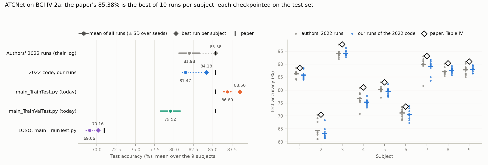

# Reproduction: ATCNet on BCI IV 2a, and what its 85.38% is made of

This directory validates the BCI IV 2a results of

> H. Altaheri, G. Muhammad, M. Alsulaiman, *Physics-Informed Attention Temporal Convolutional Network for EEG-Based
> Motor Imagery Classification*, IEEE TII 19(2):2249–2258, 2023

with the authors' code ([Altaheri/EEG-ATCNet](https://github.com/Altaheri/EEG-ATCNet), TensorFlow): 85.38% accuracy
(κ 0.805) subject-dependent, training on session T and testing on session E (Tables IV–V), and 70.97% (κ 0.613)
leave-one-subject-out (Table VI).

## Why this experiment exists

The paper's training section (III-C) gives the optimizer, "1000 epochs with a patience of 300", and nothing about
validation data or which of several runs is reported. The repository answers both, in two versions:

- **The code behind the paper.** Commit `3a318b2` (2022-08-18, nine days after the paper went online) uploaded
  `main.py`, `models.py`, the log of the training runs (10 per subject) and the best run's weights per subject. In
  `main.py` the test session is the Keras validation data, so the saved checkpoint is the epoch with the best *test*
  accuracy, early stopping watches test accuracy too, and `test()` reports, per subject, the run with the best test
  accuracy. The log ends with `Average all subjects - best run: Accuracy = 0.8538 Kappa = 0.8050` (the paper's numbers)
  and `Average all subjects - all runs: Accuracy = 0.8198 Kappa = 0.7598`. This folder was deleted on 2023-12-31.
- **Today's code** (`65162fb`). `main_TrainTest.py` keeps that protocol (the README says it "follows the methodology
  described in Paper 1, but its evaluation approach does not align with current best practices"), with a rewritten
  model (L2 weight decay, conv max-norm, a learning-rate schedule). `main_TrainValTest.py`, which the README recommends,
  holds out 20% of session T for validation and touches the test session once; its README table reports 81.10% for
  ATCNet (one seed).

So the question is how much of 85.38% is ATCNet and how much is the protocol: the test-set checkpoint and the best
of 10 runs.

## Protocols

| Tag | Code | Validation data (checkpoint, early stopping) | Reported | Runs |
|---|---|---|---|---|
| `paper2022` | 2022 `main.py` + `models.py` (`3a318b2`), lr 0.0009 | session E = the test set | best of 10 runs per subject (`test()`), and the mean of all runs | 9 subjects × 10 seeds |
| `traintest` | `main_TrainTest.py` (today), lr 0.001, L2, max-norm, ReduceLROnPlateau | session E = the test set | same | 9 × 10 |
| `trainvaltest` | `main_TrainValTest.py` (today), 500 epochs | 20% of session T | mean over seeds (test set used once) | 9 × 10 |
| `loso` | `main_TrainTest.py` with `LOSO=True` | the held-out subject = the test set | best of 3 runs per fold, and the mean | 9 folds × 3 seeds |

Every run stores its per-epoch curves (`results/curves/`), so the test accuracy at other epochs can be read off
without retraining. 297 runs, 2026-10-22.

## Results

### The paper's number is the best of 10 runs per subject, each checkpointed on the test set

**The paper's models reproduce exactly.** The nine best-of-10 models from `3a318b2`, scored on our copy of the data
by the 2022 `test()` (`code/eval_paper_weights.py`, `results/paper_weights_log.txt`), give 85.38% / κ 0.8050 and,
per subject, the accuracies of the authors' log. Today's released weights (`results/saved models/run-1`) give 81.10% / 0.748,
every subject equal to the upstream README (`code/eval_released_weights.py`, `results/released_weights_log.txt`). Our
data and preprocessing are the authors'.

Accuracy (%) and κ, mean over the 9 subjects (`code/analyze.py`, `results/results.txt`):

| | Accuracy | κ | − paper | Wilcoxon p vs. paper (9 subjects) |
|---|---|---|---|---|
| **Paper**, Tables IV–V | **85.38** | 0.805 | | |
| Authors' 2022 runs (their log): best of 10 per subject | 85.38 | 0.805 | +0.00 | |
| Authors' 2022 runs (their log): mean of all 90 | 81.98 | 0.760 | −3.40 | 0.0039 |
| 2022 code, our runs: best of 10 per subject | 84.18 | 0.789 | −1.20 | 0.020 |
| 2022 code, our runs: mean of all 90 | **81.47** | 0.753 | −3.91 | 0.0039 |
| `main_TrainTest.py` (today): best of 10 per subject | 88.50 | 0.847 | +3.12 | 0.055 |
| `main_TrainTest.py` (today): mean of all 90 | 86.89 | 0.825 | +1.51 | 0.16 |
| `main_TrainValTest.py` (today): mean of 10 seeds | **79.52** | 0.727 | −5.86 | 0.0039 |
| `main_TrainValTest.py`: seed 1 only (the upstream README's configuration; README: 81.10 / 0.748) | 81.17 | 0.749 | −4.21 | 0.012 |
| **Paper**, LOSO, Table VI | **70.97** | 0.613 | | |
| LOSO, `main_TrainTest.py`: best of 3 per fold | 70.16 | 0.602 | −0.81 | |
| LOSO, `main_TrainTest.py`: mean of all 27 | 69.06 | 0.587 | −1.91 | |

The SD of the grand mean over seeds is 0.34 pp for the 2022 code, 0.49 for `main_TrainTest.py`, 1.29 for
`main_TrainValTest.py` and 0.42 for LOSO; per subject and run, results spread by 1–5 pp (per-subject table below).

- **85.38% is a best-of-10 statistic.** The authors' own runs average 81.98%; picking each subject's best run by its
  test accuracy adds 3.40 pp (9 of 9 subjects higher, p = 0.0039). In our runs of the same code the pick adds
  2.72 pp; drawing k of the 10 runs, the expected best rises from 81.47% (k = 1) to 82.36 (2), 82.82 (3), 83.40 (5)
  and 84.18 (10).
- **Each of those runs was itself checkpointed on the test set.** In our 2022-code runs the saved epoch is 3.55 pp
  above the run's mean test accuracy over its last 50 epochs and 3.33 pp above its last epoch (`checkpoint − last
  epoch`, per-run table below). In every run the reported accuracy equals the highest test accuracy of any epoch.
- **The code behind the paper reproduces the authors' runs.** Our 90 runs of the 2022 code average 81.47% against
  their 81.98% (−0.52 pp; runs pooled, Mann-Whitney p = 0.77; per subject 3 of 9 higher, Wilcoxon p = 0.055). The
  best-of-10 is 84.18% here and 85.38% there: a maximum of 10 noisy runs, it differs more between two sets of runs
  than the mean does.
- **Without the test set, ATCNet reaches 79.5%.** With the protocol the authors now recommend (20% of session T for
  validation), 10 seeds give 79.52% ± 1.29 (κ 0.727), 5.86 pp below the paper on 9 of 9 subjects. The test set would
  have picked a better epoch in the same runs (83.54%, +4.02 pp), and our seed 1 reproduces the README's 81.10% to the
  trial on 8 of 9 subjects (81.17%; subject 8: 83.68 vs. 82.99).
- **Today's `main_TrainTest.py` is not the code behind the paper.** Under the same test-set protocol it scores
  86.89% per run, 5.42 pp above the 2022 code (9 of 9 subjects, p = 0.0039), and 88.50% as best of 10. The rewrite of
  2023-12-28 (L2 weight decay, max-norm 0.6 on every conv kernel, no max-norm on the dense layers, lr 0.001 and
  `ReduceLROnPlateau`) helps when the test set picks the epoch; with a validation split the same model gives 79.52%.
- **LOSO reproduces within 1–2 pp, and the test set does more work there.** Best of 3 gives 70.16% (paper 70.97%; the
  paper does not say how many runs it picked from), the mean 69.06%. In LOSO the held-out subject is the validation data, and the saved epoch is
  8.83 pp above the last epoch trained (8.62 above the last-50 mean): cross-subject test accuracy is noisy, so picking
  its maximum inflates more. The 2022 code cannot run LOSO as uploaded (its `load_data_LOSO` calls `load_data` with
  the arguments in the wrong order), so Table VI did not come from that code.



### Per subject

Accuracy (%); "best" is the released `test()` rule (each subject's run with the highest test accuracy), "mean ± SD" is
over the runs (10; LOSO 3).

| Subject | Paper (Table IV) | Authors' 2022 runs: best | Authors' 2022 runs: mean ± SD | 2022 code, ours: best | 2022 code, ours: mean ± SD | `main_TrainTest.py`: best | `main_TrainTest.py`: mean ± SD | `main_TrainValTest.py`: mean ± SD | LOSO: best of 3 | LOSO: mean ± SD |
|---|---|---|---|---|---|---|---|---|---|---|
| 1 | 88.5 | 88.54 | 86.29 ± 1.31 | 88.54 | 85.80 ± 1.51 | 92.36 | 90.97 ± 1.29 | 84.51 ± 2.26 | 76.74 | 75.98 ± 0.70 |
| 2 | 70.5 | 70.49 | 64.48 ± 3.44 | 68.40 | 63.30 ± 2.11 | 75.69 | 74.44 ± 1.17 | 62.92 ± 4.11 | 54.34 | 52.89 ± 1.81 |
| 3 | 97.6 | 97.57 | 94.10 ± 1.51 | 96.18 | 94.17 ± 0.99 | 97.57 | 96.49 ± 0.89 | 90.21 ± 3.27 | 84.38 | 83.91 ± 0.44 |
| 4 | 81.0 | 80.90 | 76.77 ± 2.72 | 77.78 | 75.31 ± 1.24 | 88.89 | 86.46 ± 1.69 | 79.79 ± 1.60 | 63.37 | 62.38 ± 0.89 |
| 5 | 83.0 | 82.99 | 80.17 ± 1.50 | 82.29 | 79.51 ± 1.48 | 82.29 | 79.55 ± 1.56 | 71.08 ± 4.67 | 62.67 | 61.23 ± 1.26 |
| 6 | 73.6 | 73.61 | 71.18 ± 1.79 | 73.96 | 70.56 ± 2.00 | 79.51 | 77.40 ± 2.03 | 68.54 ± 2.96 | 57.64 | 56.13 ± 1.57 |
| 7 | 93.1 | 93.06 | 89.86 ± 3.12 | 91.67 | 89.06 ± 2.69 | 97.22 | 96.11 ± 0.92 | 91.08 ± 2.15 | 77.26 | 75.00 ± 2.26 |
| 8 | 90.3 | 90.28 | 87.22 ± 1.41 | 89.24 | 87.57 ± 1.05 | 89.58 | 88.06 ± 0.91 | 80.52 ± 2.32 | 79.34 | 79.05 ± 0.36 |
| 9 | 91.0 | 90.97 | 87.78 ± 1.96 | 89.58 | 87.92 ± 1.05 | 93.40 | 92.53 ± 1.09 | 87.05 ± 1.54 | 75.69 | 74.94 ± 0.78 |
| **Avg** | **85.38** | **85.38** | **81.98** | **84.18** | **81.47** | **88.50** | **86.89** | **79.52** | **70.16** | **69.06** |

The paper's Table IV is the authors' best run per subject, rounded to one decimal, except subject 4 (printed 81.0;
the log and the saved model give 80.90).

### Per run: where the reported epoch sits

Mean ± SD over runs; test accuracy in %. For `paper2022`, `traintest` and LOSO the per-epoch validation accuracy *is*
the test accuracy; for `trainvaltest` the test accuracy was recorded after every epoch but never used.

| Quantity | 2022 code | `main_TrainTest.py` | `main_TrainValTest.py` | LOSO |
|---|---|---|---|---|
| test acc. of the saved checkpoint (reported) | 81.47 ± 9.66 | 86.89 ± 7.79 | 79.52 ± 9.88 | 69.06 ± 10.65 |
| test acc. at the last epoch trained | 78.14 ± 9.78 | 83.04 ± 8.94 | 78.96 ± 9.84 | 60.23 ± 13.19 |
| mean test acc. of the last 50 epochs | 77.91 ± 9.64 | 82.77 ± 8.73 | 78.65 ± 9.83 | 60.44 ± 13.25 |
| highest test acc. of any epoch | 81.47 ± 9.66 | 86.89 ± 7.79 | 83.54 ± 9.14 | 69.06 ± 10.65 |
| checkpoint − last epoch (pp) | 3.33 ± 1.76 | 3.85 ± 2.32 | 0.56 ± 3.42 | 8.83 ± 5.10 |
| checkpoint − mean of the last 50 epochs (pp) | 3.55 ± 1.08 | 4.12 ± 1.62 | 0.87 ± 2.76 | 8.62 ± 4.15 |
| epochs trained | 698 ± 191 | 790 ± 179 | 500 | 524 ± 192 |
| epoch of the checkpoint | 412 ± 218 | 516 ± 214 | 444 ± 60 | 224 ± 192 |
| training accuracy, mean of the last 50 epochs | 99.96 | 99.99 | 99.99 | 93.31 |
| minutes per run (2 runs per Quadro M6000) | 8.6 | 10.1 | 7.2 | 72.9 |

Training accuracy is ≈ 100% at the end of every subject-dependent run, so after a few hundred epochs the test curve
only fluctuates; with the test set as validation data, the checkpoint keeps the highest fluctuation and early stopping
ends the run 300 epochs later.

## Paper vs. this reproduction

### What differs, and why

Three versions are involved: the paper; the code that produced its numbers (upstream `3a318b2`, 2022-08-18:
`main.py`, `models.py`, and the log and best-of-10 weights in `results/`); and the current code (`65162fb`:
`main_TrainTest.py`, which its README says "follows the methodology described in Paper 1", and `main_TrainValTest.py`,
which it recommends instead).

| | Paper | 2022 code (`3a318b2`) | Current code (`65162fb`) | This experiment | Why |
|---|---|---|---|---|---|
| Data files | BCI Competition IV 2a | BNCI Horizon 2020 001-2014 `.mat` files, `<path>/s<N>/A0<N>{T,E}.mat` | same | the same files (`datasets/download.sh bciciv2a`), linked into that layout by `code/paths.py` | the authors' weights give the same predictions on our copy (see Results) |
| Trial window, preprocessing | 4.5 s (T = 1125), "without preprocessing" | 1.5–6 s after trial start, 22 EEG channels, all 288 trials incl. those marked as artifacts, each channel z-scored with `StandardScaler` fitted on the training trials | same | same | run as released |
| Validation data | not stated | session E (the test set) is passed to `model.fit` as validation data | `main_TrainTest.py`: session E; `main_TrainValTest.py`: 20% of session T (`train_test_split`, `random_state=42`) | all three | this is the question |
| Checkpoint, early stopping | "1000 epochs with a patience of 300" | best `val_accuracy`; `EarlyStopping(val_accuracy, patience 300)` | `main_TrainTest.py`: same, plus `ReduceLROnPlateau(val_loss, 0.9, 20, min 1e-4)`; `main_TrainValTest.py`: best `val_loss`, no early stopping, 500 epochs | as released | |
| Reported number | 85.38% / κ 0.805, "the proposed model" | `test()` prints the mean over subjects of the best of 10 runs (chosen by test accuracy) and the mean of all 90 runs; the authors' log shows 85.38 / 0.8050 for the first and 81.98 / 0.7598 for the second | `main_TrainTest.py`: same; `main_TrainValTest.py`: mean over all seeds (README: 81.10%, 1 seed) | both rules from every run | |
| Learning rate | 0.0009 | 0.0009 | 0.001 | as each code version | |
| Regularization | dropout (Table I) | dropout; max-norm 1.0 on the depthwise kernels and 0.25 on the dense layers | dropout; L2 0.009 on all conv kernels and 0.5 on the dense layers, max-norm 0.6 on all conv kernels, none on the dense layers | as each code version | |
| Window fusion | outputs of the 5 windows concatenated, then one FC layer (Sec. II-E, Fig. 1) | one dense layer per window, outputs averaged (`fuse='average'`) | same | as the code | |
| Other layers not in the paper | – | dropout 0.3 after the attention, before the residual add | same | as the code | |
| Initialisation | Glorot uniform | Keras defaults (Glorot uniform), He uniform in the TCN | same | as the code | |
| Parameters | 115.2K | 113,732 trainable + 1,440 BatchNorm moving statistics = 115,172 | same | same | the paper counts the non-trainable statistics |
| Seeds | not reported | none set | `tf.random.set_seed` / `np.random.seed` = run number 1–10 | run numbers 1–10 as seeds in all protocols | repeatable runs |
| Optimizer instance | – | one `Adam` created in `train()` and reused by all 90 runs, so each run after the first starts with Adam's step counter at ≥ 1500 and (nearly) no bias correction | a new `Adam` per run | 2022 code: a new `Adam` per run with its step counter set to 100000 (bias correction off), except subject 1 / run 1 | one process per run; this reproduces the shared instance's state for 89 of the 90 runs |
| LOSO | 70.97% / κ 0.613 (Table VI) | `load_data_LOSO` calls `load_data(sub+1, True, path)` with its arguments in the wrong order, so LOSO cannot run | works: 8 subjects × 576 trials train; the held-out subject's 576 trials are validation and test data | current `main_TrainTest.py` with `LOSO=True`, 3 seeds | the 2022 code cannot produce Table VI as uploaded |
| Hardware, software | "Nvidia GTX 2070 8 GB", TensorFlow | – | README: Python 3.7, TensorFlow 2.7 | Quadro M6000 12 GB (2 runs per GPU, 5 GB cap each), Python 3.7.12, TensorFlow 2.7.0, CUDA 11.2, cuDNN 8.1 | the hardware we have; the software the README lists |

Every changed line of the training loops is marked `# [MOD]` in `code/run_paper2022.py` and `code/run_released.py`.

### Settings we had to choose

| Setting | Value | Why |
|---|---|---|
| Runs per subject | 10 (2022 code, `main_TrainTest.py`, `main_TrainValTest.py`); 3 for LOSO | 10 is the code's `n_train` and what the paper's best-of-10 rule needs; a LOSO run trains on 16× more data (~1.5–2 h), so LOSO has 3 seeds and its "best of" is best of 3 |
| `main_TrainValTest.py` configuration | `dataset = 'BCI2a'`, 10 seeds | its `run()` is set to the High Gamma Dataset with `n_train = 1`; the README's 81.10% is BCI IV 2a with 1 seed (reported separately as "seed 1") |
| Per-epoch test accuracy in `main_TrainValTest.py` runs | evaluated after every epoch by an extra callback, never used for selection | to compare the validation-selected epoch with the epoch the test set would have picked |
| GPU sharing | 2 runs per GPU, each capped at 5 GB, 2 intra-op threads | 3 runs per GPU without a cap ran out of memory |

### Run configuration

ATCNet as in each code version's `getModel('ATCNet')`: 5 windows, multi-head attention (2 heads, key size 8,
dropout 0.5), conv block F1 = 16, D = 2, kernel 64, pools 8 and 7, dropout 0.3, TCN depth 2, kernel 4, 32 filters,
dropout 0.3, ELU, `fuse='average'`. Batch 64, categorical cross-entropy, Keras Adam (β 0.9 / 0.999, ε 1e-7).
2022 code: lr 0.0009, 1000 epochs, patience 300. `main_TrainTest.py`: lr 0.001, 1000 epochs, patience 300,
ReduceLROnPlateau. `main_TrainValTest.py`: lr 0.001, 500 epochs, ReduceLROnPlateau. Environment: `env/setup_env.sh`
(conda env `atcnet-tf`), `env/pip_freeze.txt`. Hardware: mcl-server, 8× Quadro M6000 12 GB. As in the other
experiments on that server, the runs need `LD_LIBRARY_PATH=~/repro-braindecode/nvml-580.173.02/lib` while its NVIDIA
user-space libraries (580.178.04) do not match the loaded kernel module (580.173.02); see
[../../../eeg-conformer/experiments/braindecode-bciciv2a](../../../eeg-conformer/experiments/braindecode-bciciv2a).

## Layout

```
code/paths.py                 data and work paths; data layout the released code expects; extracts the 2022 code
code/run_paper2022.py         one run of the 2022 code (train() of main.py at 3a318b2, one subject and run)
code/run_released.py          one run of today's code: main_TrainTest.py (traintest, loso) or main_TrainValTest.py
code/curves.py                Keras callback that records every epoch
code/add_jobs.py              queues all runs for tools/run_queue.py
code/eval_paper_weights.py    the paper's best-of-10 models, scored by the 2022 test()      -> results/paper_weights_log.txt
code/eval_released_weights.py today's released weights, scored by main_TrainValTest.test() -> results/released_weights_log.txt
code/analyze.py               every table in this README                                  -> results/results.json
code/make_figure.py           results/fig_reported_vs_reproduced.png
code/export_summary.py        results/summary.csv (feeds RESULTS.md)
env/setup_env.sh, env/pip_freeze.txt   conda env atcnet-tf (TensorFlow 2.7)
results/curves/<protocol>/s<sub>_seed<seed>.npz   per-epoch loss, accuracy, val_loss, val_accuracy, lr (and test
                              accuracy for trainvaltest), test predictions, accuracy and kappa of every run
results/authors_2022_log.txt, authors_2022_best_models.txt   the authors' log and best-run list, from upstream 3a318b2
results/results.txt           output of code/analyze.py
logs/runs/<protocol>_s<sub>_seed<seed>.txt   console output of every run; logs/queue.log
```

## Reproducing

Recompute every number and the figure from the committed outputs (numpy, scipy, matplotlib):

```bash
cd methods/atcnet/experiments/bciciv2a-model-selection
mkdir -p results_rerun && cp -r results/curves results/authors_2022_log.txt results_rerun/
python code/analyze.py results_rerun > results_rerun/results.txt && diff results_rerun/results.txt results/results.txt
python code/make_figure.py results_rerun
```

Re-run the training (GPU; needs the BCI IV 2a files, `datasets/download.sh bciciv2a`, and the submodule with its
history, which `git clone --recurse-submodules` provides):

```bash
bash env/setup_env.sh                                  # conda env atcnet-tf
python code/eval_paper_weights.py results_rerun        # 85.38 / 0.8050 if the data match
python code/eval_released_weights.py results_rerun     # 81.10 / 0.748
python code/add_jobs.py                                # queue the 297 runs (see the docstring for subsets)
RUN_QUEUE_DIR=~/repro-atcnet/queue python ../../../../tools/run_queue.py 0 1 2 3 4 5 6 7 0 1 2 3 4 5 6 7
```

A single run: `python code/run_released.py --protocol traintest --subject 1 --seed 1` or
`python code/run_paper2022.py --subject 1 --seed 1` (outputs under `$ATCNET_WORK`, default `~/repro-atcnet`).
