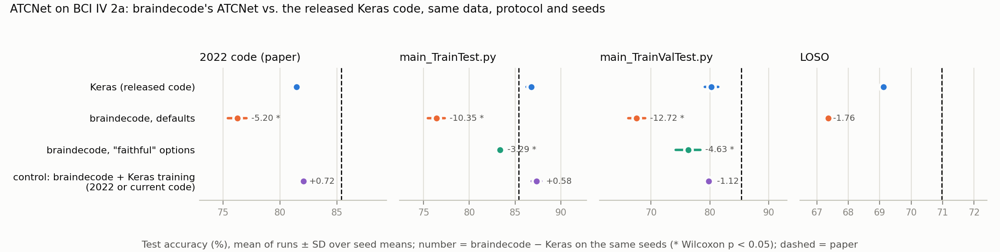

# ATCNet as implemented in braindecode, trained like the released code

[bciciv2a-model-selection](../bciciv2a-model-selection) ran the authors' TensorFlow code for ATCNet. The upstream
README points to braindecode's `ATCNet` as the PyTorch version. This experiment asks:

> Is braindecode's `ATCNet` (braindecode 1.8.1) the released network, and does it reproduce the released code's
> numbers when trained the same way?

The released code is TensorFlow, so braindecode's model cannot be dropped into it as in the other braindecode
experiments. `code/run_braindecode.py` instead ports the released training loops to PyTorch and keeps everything
else of the released runs: the released `preprocess.get_data()` (imported unchanged), Keras' `model.fit` semantics
(reshuffle every epoch, batches of 64 including the last partial one, Adam with Keras' defaults), the released
callbacks (checkpoint, `ReduceLROnPlateau`, early stopping) and the same seeds. Protocols as in the released-code
experiment:

| Protocol | Released counterpart | Validation data | Learning rate, schedule |
|---|---|---|---|
| `paper2022` | the 2022 `main.py` behind the paper | session E (the test set) | 0.0009, none; Adam bias correction off, as with the Adam instance the 2022 loop shares across runs |
| `traintest` | today's `main_TrainTest.py` | session E (the test set) | 0.001, `ReduceLROnPlateau` |
| `trainvaltest` | today's `main_TrainValTest.py` | 20% of session T | 0.001, `ReduceLROnPlateau`, 500 epochs |
| `loso` | `main_TrainTest.py` with `LOSO=True` | the held-out subject | 0.001, `ReduceLROnPlateau` |

and settings of the model:

| Setting | Model and optimizer |
|---|---|
| `default` | `ATCNet(n_chans=22, n_outputs=4, n_times=1125)`, plain Adam: braindecode out of the box |
| `faithful` | `ATCNet(..., conv_max_norm_const=0.6)` and `Adam(model.source_optimizer_param_groups())`: the options braindecode documents for matching the official code |
| `keras2022`, `keras` (controls) | braindecode's network with every training-time difference to the 2022 / current Keras model switched to the Keras behaviour (next section). If a control reproduces the Keras runs, the PyTorch port of the loop is faithful and the gap of `default` comes from the model |
| `default+<switch>` (ablation) | braindecode's defaults with one of those Keras behaviours switched on, in the 2022 loop |

## Is braindecode's ATCNet the released network?

`code/export_keras.py` (TensorFlow env) loads two sets of the authors' trained weights into the Keras model that
trained them, the 2022 best-of-10 models behind the paper and today's released weights, and exports the weights and
the Keras logits on session E; `code/check_equivalence.py` (braindecode env) loads the same weights into braindecode's
`ATCNet` and compares (`results/equivalence.txt`):

- **Same architecture.** The 195 weight tensors map one to one (113,732 trainable parameters in both), layer by layer
  and in the same order of heads, windows and channels.
- **Same forward pass, once BatchNorm's eps matches.** braindecode uses eps 1e-4 in the conv block and 1e-5 in the
  TCN; Keras uses 1e-3. With braindecode's values, the authors' trained models change their predictions on 34 of 2,592
  test trials (paper's models: 85.38% → 84.53%) and 191 of 2,592 (today's weights: 81.10% → 80.63%), with logit
  differences up to 3.3. With eps 1e-3, all 2,592 predictions agree and the logits differ by at most 7.9e-4; removing
  the max-norm parametrization of the final layer (whose eps term rescales the weights by ~1e-4 even when no norm
  exceeds the limit) brings this to 3.3e-6, float32 rounding.

| Authors' weights | Keras | braindecode as is | + Keras BatchNorm eps | + no final-layer max-norm |
|---|---|---|---|---|
| Paper's best-of-10 models (`3a318b2`) | 85.38% | 84.53% (2,558 / 2,592 predictions agree; max logit diff. 0.62) | 85.38% (2,592; 7.9e-4) | 85.38% (2,592; 3.3e-6) |
| Today's released weights (`run-1`) | 81.10% | 80.63% (2,401 / 2,592; 3.26) | 81.10% (2,592; 5.8e-4) | 81.10% (2,592; 1.7e-6) |

### What else differs: training-time behaviour

The forward pass cannot show these; they only act during training.

| | Keras, current code | Keras, 2022 code (paper) | braindecode `ATCNet` defaults | controls `keras` / `keras2022` |
|---|---|---|---|---|
| BatchNorm eps / momentum | 1e-3 / 0.99 | 1e-3 / 0.99 | 1e-4 (conv block), 1e-5 (TCN) / 0.1 in PyTorch's convention (= 0.9 in Keras') | 1e-3 / 0.01 in PyTorch's convention (= Keras 0.99) |
| Dropout in the conv block (0.3) | element-wise | element-wise | `Dropout2d`: whole feature maps | element-wise |
| Attention dropout (0.5) | on the attention weights | on the attention weights | on the attention block's output | on the attention weights |
| Final dense layers | L2 0.5, no max-norm | max-norm 0.25 per output unit | **max-norm 0.25 per *input feature*** (`MaxNorm` over dim 0 of the (out, in) weight), as a parametrization | L2 0.5, no max-norm (`keras`); max-norm 0.25 per output unit (`keras2022`) |
| Conv kernels | L2 0.009, max-norm 0.6 | max-norm 1.0 on the depthwise kernel only | none (`conv_max_norm_const=None`) | L2 0.009 and max-norm 0.6 after every step (`keras`); depthwise max-norm 1.0 (`keras2022`) |
| Initialisation | Glorot uniform (He uniform in the TCN), zero biases | same | PyTorch defaults (He uniform in the TCN) | Keras' |

braindecode's `ATCNet` docstring and `source_optimizer_param_groups()` describe how to get closer to the official code:
`conv_max_norm_const=0.6` and `Adam(model.source_optimizer_param_groups())`, which applies weight decay 0.009 to the
conv kernels and 0.5 to the final dense weights. Keras' `L2(λ)` adds λ·‖w‖² to the loss, whose gradient is 2λ·w;
Adam's coupled `weight_decay=λ` adds λ·w. The helper therefore applies half the official penalty. The `faithful`
variant uses the helper as documented.

## Results

`code/analyze.py` prints every table below (`results/results.txt`). Accuracy in %, mean over the 9 subjects of the
per-subject mean over seeds; each braindecode setting is compared with the Keras runs of the same seeds, paired by
subject (two-sided Wilcoxon signed-rank test over the 9 subjects).

### In the paper's protocol, braindecode's defaults lose 5 pp

The 2022 loop behind the paper (session E as validation data, lr 0.0009, no schedule), 10 seeds:

| | Keras, 2022 code | braindecode `ATCNet`, defaults | braindecode − Keras | control `keras2022` (seeds 1–3) |
|---|---|---|---|---|
| Mean of runs | 81.47 | 76.26 | −5.20 (p = 0.0039) | 82.06 (Keras on the same seeds 81.34) |
| Best of 10 per subject (the paper's rule) | 84.18 | 79.48 | −4.71 (p = 0.012) | – |

braindecode's defaults are lower on 9 of 9 subjects. The control, braindecode's network with the 2022 Keras
training behaviour, is level with the Keras runs (+0.72 pp on its seeds, p = 0.57), so the PyTorch port of
the loop is faithful and the gap lies in braindecode's defaults.

### The cause: the axis of the final layer's max-norm

The 2022 Keras model constrains each of its dense output units to an L2 norm ≤ 0.25 (`max_norm(0.25)` on a
(32, 4) kernel normalizes over the 32 inputs). braindecode's `MaxNormLinear`, documented as the "equivalent of Keras
`tf.keras.Dense(..., kernel_constraint=max_norm())`", normalizes its (4, 32) weight over dim 0, i.e. it constrains each
of the 32 *input features* across the 4 outputs. Switching single Keras behaviours on in braindecode's defaults
(2022 loop; seed 1, the two max-norm rows seeds 1–2):

| Switched on | Seeds | Accuracy | − braindecode defaults (p) | − Keras 2022 code (p) |
|---|---|---|---|---|
| none (braindecode defaults) | 1–10 | 76.26 | – | −5.20 (0.0039) |
| element-wise dropout in the conv block (Keras `Dropout`, not `Dropout2d`) | 1 | 78.40 | +1.50 (0.82) | −2.35 (0.098) |
| attention dropout on the attention weights | 1 | 76.31 | −0.58 (0.057) | −4.44 (0.012) |
| Keras BatchNorm (eps 1e-3, momentum 0.99) | 1 | 77.35 | +0.46 (0.43) | −3.40 (0.055) |
| Keras initialisers | 1 | 76.20 | −0.69 (0.43) | −4.55 (0.012) |
| max-norm 1.0 on the depthwise kernel (2022 code) | 1 | 77.62 | +0.73 (0.091) | −3.13 (0.039) |
| **final max-norm 0.25 per output unit, braindecode's parametrization (`dim=1`)** | 1–2 | 80.48 | +3.68 (0.0039) | −0.89 (0.43) |
| **final max-norm 0.25 per output unit, Keras projection after every step** | 1–2 | 81.37 | +4.57 (0.0039) | +0.00 (0.65) |
| all of the above (control `keras2022`) | 1–3 | 82.06 | +5.13 (0.0039) | +0.72 (0.57) |

Of the differences tested, only the max-norm axis matters: with braindecode's own parametrization, changing nothing but the axis (`dim=1`)
recovers +3.68 pp (p = 0.0039) and leaves the model −0.89 pp from the Keras code (p = 0.43);
with a Keras-style projection after every step it recovers +4.57 pp. Dropout2d, the attention-dropout placement,
BatchNorm's eps and momentum, the initialisers and the depthwise max-norm each change the result by at most
1.5 pp, none significantly. braindecode's `EEGTCNet` uses the same `MaxNormLinear` (not tested here).

### In today's protocols the gap doubles

Today's Keras model adds L2 weight decay (0.009 on the conv kernels, 0.5 on the dense layers) and a 0.6 max-norm on
every conv kernel, and drops the dense max-norm. braindecode's defaults have none of this, and keep the
per-input-feature max-norm. Accuracy (%), braindecode − Keras on the same seeds (Wilcoxon p over the 9 subjects):

| Protocol | Keras | braindecode defaults | "faithful" options | control `keras` |
|---|---|---|---|---|
| `main_TrainTest.py` (session E as validation data), mean of runs | 86.76 (seeds 1–5) | 76.41: −10.35 (0 of 9 higher, p = 0.0039) | 83.37: −3.29 (0 of 9, p = 0.0039; seeds 1–3) | 87.34: +0.58 (8 of 9, p = 0.055) |
| `main_TrainTest.py`, best run per subject | 88.12 (best of 5) | 79.01: −9.10 (p = 0.0039) | 84.80: −3.09 (best of 3, p = 0.0039) | 89.08: +0.96 (p = 0.028) |
| `main_TrainValTest.py` (20% of session T), mean of runs | 80.29 (seeds 1–5) | 67.57: −12.72 (0 of 9, p = 0.0039) | 76.31: −4.63 (1 of 9, p = 0.0078; seeds 1–3) | 79.82: −1.12 (3 of 9, p = 0.13; seeds 1–3) |
| LOSO, seed 1 | 69.12 | 67.36: −1.76 (3 of 9, p = 0.20) | – | – |

- **The control is level with Keras in today's loops too** (+0.58 and −1.12 pp, not significant on the means), so the
  port is faithful and every gap above belongs to braindecode's defaults. Its best-of-5 is 0.96 pp higher (p = 0.028).
- **braindecode's "faithful" options close two thirds of the gap, not all of it.** They add the conv max-norm and
  weight decay but keep the per-input-feature max-norm on the final layer, and `source_optimizer_param_groups()`
  applies half the Keras penalty: Keras' `L2(λ)` adds λ‖w‖² to the loss (gradient 2λw), Adam's coupled
  `weight_decay=λ` adds λw.
- **`main_TrainValTest.py` hits braindecode's defaults hardest** (−12.72 pp). Its checkpoint is the epoch with the
  lowest validation loss. Keras includes the L2 penalty in `val_loss`, and the penalty keeps falling as the weights
  shrink, so the Keras checkpoint lands late (epoch 444 ± 60 of 500). Without a penalty, braindecode's validation
  cross-entropy is lowest early (epoch 187 ± 142), and the checkpoint is 3.05 pp *worse* than the last epoch.
- **Cross-subject the gap is small** (LOSO, one seed: −1.76 pp, not significant).
- **No braindecode setting comes closer to the paper.** Under the paper's own protocol and rule (2022 loop, best of
  10), braindecode's defaults give 79.48%, 5.90 pp below the paper's 85.38%; the Keras code gives 84.18%.

### Per subject, braindecode defaults vs. Keras

Mean ± SD over seeds (accuracy, %; LOSO: seed 1).

| Subject | 2022 loop: Keras | 2022 loop: braindecode | `main_TrainTest.py`: Keras | `main_TrainTest.py`: braindecode | `main_TrainValTest.py`: Keras | `main_TrainValTest.py`: braindecode | LOSO: Keras | LOSO: braindecode |
|---|---|---|---|---|---|---|---|---|
| 1 | 85.80 ± 1.51 | 78.26 ± 0.81 | 91.11 ± 1.14 | 80.21 ± 1.79 | 85.28 ± 1.91 | 64.72 ± 3.77 | 75.87 | 73.26 |
| 2 | 63.30 ± 2.11 | 61.11 ± 2.52 | 73.89 ± 1.38 | 61.88 ± 3.16 | 64.03 ± 3.70 | 45.83 ± 2.02 | 53.47 | 54.69 |
| 3 | 94.17 ± 0.99 | 89.90 ± 1.24 | 96.18 ± 1.13 | 91.25 ± 0.90 | 90.07 ± 3.68 | 87.22 ± 1.14 | 84.38 | 79.69 |
| 4 | 75.31 ± 1.24 | 72.85 ± 2.31 | 86.94 ± 1.14 | 72.64 ± 1.62 | 79.44 ± 1.88 | 63.54 ± 3.34 | 63.37 | 62.85 |
| 5 | 79.51 ± 1.48 | 74.51 ± 1.85 | 79.86 ± 1.07 | 72.85 ± 2.30 | 73.12 ± 3.03 | 67.08 ± 4.13 | 60.42 | 63.54 |
| 6 | 70.56 ± 2.00 | 70.45 ± 1.68 | 76.53 ± 2.65 | 68.12 ± 2.57 | 69.03 ± 3.62 | 58.47 ± 3.15 | 57.64 | 53.65 |
| 7 | 89.06 ± 2.69 | 75.97 ± 3.77 | 96.04 ± 1.19 | 77.57 ± 3.15 | 92.64 ± 1.65 | 72.57 ± 4.77 | 72.74 | 76.22 |
| 8 | 87.57 ± 1.05 | 83.09 ± 0.79 | 88.19 ± 0.89 | 82.99 ± 0.69 | 81.74 ± 1.78 | 75.35 ± 1.98 | 79.17 | 75.17 |
| 9 | 87.92 ± 1.05 | 80.21 ± 1.86 | 92.08 ± 1.35 | 80.21 ± 2.05 | 87.29 ± 1.99 | 73.33 ± 3.25 | 75.00 | 67.19 |
| **Avg** | **81.47** | **76.26** | **86.76** | **76.41** | **80.29** | **67.57** | **69.12** | **67.36** |



## Paper vs. this reproduction

The paper's side (data, protocols, what differs between paper and released code) is in
[bciciv2a-model-selection](../bciciv2a-model-selection#paper-vs-this-reproduction). Here: what differs between
the released Keras runs and these PyTorch runs.

### What differs, and why

| | Released code (Keras runs) | This experiment | Why |
|---|---|---|---|
| Model | `models.ATCNet_` (today) / `models.ATCNet` (2022), TensorFlow 2.7 | braindecode 1.8.1 `ATCNet`, PyTorch 2.1.2 | the question |
| Training loop | Keras `model.fit` with the released callbacks | a port (`run_braindecode.py`): reshuffle every epoch, batches of 64 with the last partial batch, mean cross-entropy, Adam (lr, β 0.9/0.999, ε 1e-7), `ModelCheckpoint` / `ReduceLROnPlateau` (`min_delta` 1e-4) / `EarlyStopping` with Keras' comparisons | braindecode is PyTorch; the controls show the port reproduces the Keras runs |
| Data | `preprocess.get_data()` | the same function, imported unchanged (its `to_categorical` import served by a numpy one-hot) | identical arrays |
| Data of the 2022 loop | the 2022 `get_data()` (no shuffle) | today's `get_data()`: the same trials, shuffled with `random_state=42` | order only; training reshuffles every epoch |
| `val_loss` (checkpoint of `trainvaltest`, `ReduceLROnPlateau`) | includes the Keras L2 penalties | includes the penalty the setting trains with: none for `default`, braindecode's weight decay as an L2 term for `faithful`, the Keras terms for `keras` | each model's own objective |
| Adam step counter (2022 loop) | one instance shared by all runs | counter started at 100000 except subject 1 / seed 1 | as in the released-code experiment |
| Seeds | `tf.random` / `np.random` = run number | `torch` / `np.random` = run number | same numbers, different generators: runs do not correspond one to one across frameworks |
| Environment | conda env `atcnet-tf` | conda env `bd-cbramod` (PyTorch 2.1.2, NumPy 1.26, braindecode from the pinned submodule) | the released `preprocess.py` fails under NumPy 2 (`int()` of a 1-element array), which rules out the `eegnet` env |

### Settings we had to choose

| Setting | Value | Why |
|---|---|---|
| Seeds | `default`: 10 in the 2022 loop, 5 in today's loops, 1 for LOSO; `keras`: 5 (`traintest`), 3 (`trainvaltest`); `keras2022`: 3; `faithful`: 3; ablation: 1 (the two max-norm switches: 2) | ~8 min per run (LOSO ~50 min) on the shared GPUs; the effects found are several pp on 8–9 of 9 subjects, far above the seed spread |
| Ablation protocol | the 2022 loop | braindecode's defaults follow the 2022 model (a 0.25 max-norm on the final layer, no L2), so its 2022 loop is the comparison where only implementation details differ |
| Controls' initialisation | Glorot uniform with Keras' fan computation for the kernel shapes in Keras layout (e.g. the depthwise kernel (1, 22, 16, 2) has fan-in 352, fan-out 44), He uniform in the TCN, zero biases | PyTorch computes fans from its own weight layout |

### Run configuration

braindecode `ATCNet` defaults: F1 16, kernel 64, D 2, pools 8 and 7, dropout 0.3 (`Dropout2d`), 5 windows, 2 heads of
size 8, attention dropout 0.5, TCN depth 2, kernel 4, dropout 0.3, ELU, window outputs averaged, final `MaxNormLinear`
(0.25). Training as in the released code (see the protocol table). Environment: `env/setup_env.sh` (the `bd-cbramod`
env of the CBraMod braindecode experiment), `env/pip_freeze.txt`. Hardware: mcl-server, 8× Quadro M6000, 2 runs per
GPU, with the NVML `LD_LIBRARY_PATH` workaround of the other experiments on that server.

## Layout

```
code/export_keras.py        step 1 of the equivalence check (TensorFlow env): authors' weights and Keras logits
code/check_equivalence.py   step 2 (braindecode env): braindecode's ATCNet with those weights   -> results/equivalence.txt
code/run_braindecode.py     one run: braindecode ATCNet in the PyTorch port of a released loop (settings, switches)
code/add_jobs.py            queues every run for tools/run_queue.py
code/analyze.py             every table in this README                                         -> results/results.json
code/make_figure.py         results/fig_braindecode_vs_keras.png
code/export_summary.py      results/summary.csv (feeds RESULTS.md)
env/                        setup script and pip freeze of the braindecode env
results/curves/<setting>/<protocol>/s<sub>_seed<seed>.npz   per-epoch curves and test predictions of every run
results/results.txt         output of code/analyze.py
logs/runs/*.txt             console output of every run; logs/queue.log
```

## Reproducing

Recompute every number from the committed outputs (numpy, scipy, matplotlib; reads the Keras curves of
`../bciciv2a-model-selection/results/curves`):

```bash
cd methods/atcnet/experiments/braindecode-bciciv2a
mkdir -p results_rerun && cp -r results/curves results_rerun/
python code/analyze.py results_rerun > results_rerun/results.txt && diff results_rerun/results.txt results/results.txt
python code/make_figure.py results_rerun
```

Re-run (GPU): `bash env/setup_env.sh`; the equivalence check with `python code/export_keras.py released` and
`python code/export_keras.py paper` in the `atcnet-tf` env of the released-code experiment, then
`python code/check_equivalence.py`; the training runs with `python code/add_jobs.py` and `tools/run_queue.py` as in the
released-code experiment. A single run:
`python code/run_braindecode.py --variant default --protocol paper2022 --subject 1 --seed 1`.
