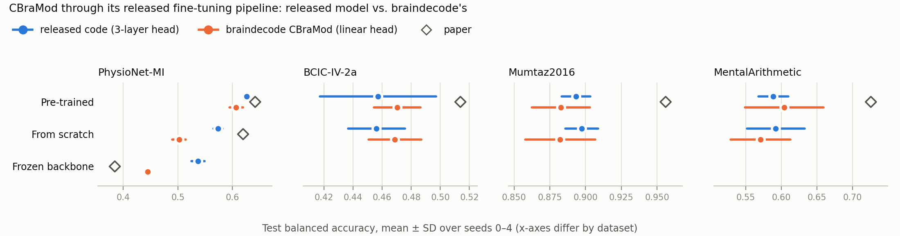

# CBraMod as implemented in braindecode, through the released fine-tuning pipeline

[finetune-public-datasets](../finetune-public-datasets) re-ran CBraMod's released fine-tuning code and weights on
four public datasets. This experiment asks:

> Does braindecode's `CBraMod`, with braindecode's pre-trained weights and fine-tuned through the same released
> pipeline, reproduce the released code's numbers (and the paper's)?

`code/run_braindecode.py` keeps everything of the released pipeline (`../../upstream`, commit `b9e9610`): CBraMod's
dataset loaders and subject splits, its `Trainer` (loss, AdamW, the 5× head learning rate of `multi_lr`, cosine
schedule, gradient clipping, label smoothing, checkpoint on the best validation κ / AUROC, one test evaluation) and
its `Evaluator`. Only the model is replaced, by braindecode's `CBraMod` ([braindecode](../../../eegnet/upstream)
v1.8.1) used the way braindecode ships it:

| Setting | Model | Released-code counterpart | Paper |
|---|---|---|---|
| `pretrained` | `CBraMod.from_pretrained('braindecode/cbramod-pretrained')` with braindecode's task head | `pretrained` | Tables 3, 10, 12, 15 |
| `scratch` | the same model, braindecode's random initialisation | `scratch` | Table 4 (PhysioNet-MI) |
| `frozen` | `pretrained` with the backbone frozen by the released `Trainer` (`--frozen`) | `frozen` (PhysioNet-MI) | Table 18 |
| `onelayer`, `onelayer-frozen` (control) | the *released* model, weights and `finetune_main.py` with the released one-layer head (`--classifier all_patch_reps_onelayer`); fine-tuned, or backbone frozen | `pretrained`, `frozen` (3-layer head) | – |

The released `Trainer` gives every parameter whose name contains `backbone` the backbone learning rate (1e-4), all
others the head learning rate (5e-4), and freezes the `backbone` ones under `--frozen`. The wrapper in
`run_braindecode.py` puts braindecode's encoder under `backbone` and its `final_layer` under `head`, so the split is
the released one. 4 datasets × {pretrained, scratch} + PhysioNet-MI frozen, seeds 0–4: 45 runs.

The control runs separate the two ways braindecode's head differs from the released one (below): the released
one-layer head is braindecode's head without the pre-trained `proj_out`. They were added after the first PhysioNet-MI
results came in below the released-code runs; PhysioNet-MI only, seeds 0–4: 10 runs.

## Is braindecode's CBraMod the released model?

`code/check_equivalence.py` (output: `results/equivalence.txt`):

- **The weights are the released weights.** braindecode's Hugging Face file (`braindecode/cbramod-pretrained`,
  revision `584cdc4`) has the same 211 tensors under the same names as the released `pretrained_weights.pth`, all
  identical, and `from_pretrained()` loads every one of them (it loads with `strict=False`, so this had to be checked).
- **The encoder is the released encoder.** Fed the same input in float64, the released backbone and braindecode's
  encoder give identical outputs (max |difference| 0) on all four datasets' input shapes.
- **The task head is not the released head.** Both encoders end with `proj_out`, the 200 → 200 linear layer that
  reconstructs patches in pre-training. The released fine-tuning `Model` replaces it with `Identity` and adds its
  `all_patch_reps` classifier: Linear(channels × patches × 200 → patches × 200) → ELU → Dropout → Linear(→ 200) →
  ELU → Dropout → Linear(→ classes). braindecode keeps the pre-trained `proj_out` (40,200 parameters, trained at the
  backbone learning rate) and adds one layer: Flatten → Linear(channels × patches × 200 → classes).

| Dataset | Released model: backbone + head | braindecode: backbone + head |
|---|---|---|
| PhysioNet-MI (64 ch., 4 s) | 4,883,800 + 41,121,804 = 46,005,604 | 4,924,000 + 204,804 = 5,128,804 |
| BCIC-IV-2a (22 ch., 4 s) | 4,883,800 + 14,241,804 = 19,125,604 | 4,924,000 + 70,404 = 4,994,404 |
| Mumtaz2016 (19 ch., 5 s) | 4,883,800 + 19,201,401 = 24,085,201 | 4,924,000 + 19,001 = 4,943,001 |
| MentalArithmetic (20 ch., 5 s) | 4,883,800 + 20,201,401 = 25,085,201 | 4,924,000 + 20,001 = 4,944,001 |

So any difference between the two sets of runs comes from the head (and from random initialisation and data order,
which the seeds do not tie together across implementations), not from the encoder or the weights.

## Results

All 55 runs finished on 2026-10-22 (mean ± std over seeds 0–4; p from Welch's t-test, as in the released-code
experiment).

### braindecode's CBraMod, pre-trained, vs. the released code and the paper

| Dataset (paper table) | Metric | Paper | Released code | braindecode | braindecode − released (p) | braindecode − paper (p) |
|---|---|---|---|---|---|---|
| PhysioNet-MI (T3) | balanced acc. | 0.6417 ± 0.0091 | 0.6265 ± 0.0054 | 0.6068 ± 0.0124 | −0.0197 (0.02) | −0.0349 (0.001) |
|  | Cohen's κ | 0.5222 ± 0.0169 | 0.5019 ± 0.0072 | 0.4757 ± 0.0165 | −0.0262 (0.02) | −0.0465 (0.002) |
|  | weighted F1 | 0.6427 ± 0.0100 | 0.6271 ± 0.0051 | 0.6075 ± 0.0124 | −0.0196 (0.02) | −0.0352 (0.001) |
| BCIC-IV-2a (T15) | balanced acc. | 0.5138 ± 0.0066 | 0.4571 ± 0.0399 | 0.4703 ± 0.0159 | +0.0132 (0.52) | −0.0435 (0.002) |
|  | Cohen's κ | 0.3518 ± 0.0094 | 0.2762 ± 0.0532 | 0.2938 ± 0.0213 | +0.0176 (0.52) | −0.0580 (0.002) |
|  | weighted F1 | 0.4984 ± 0.0085 | 0.4138 ± 0.0673 | 0.4371 ± 0.0262 | +0.0233 (0.50) | −0.0613 (0.005) |
| Mumtaz2016 (T10) | balanced acc. | 0.9560 ± 0.0056 | 0.8933 ± 0.0101 | 0.8827 ± 0.0204 | −0.0106 (0.34) | −0.0733 (<0.001) |
|  | AUC-PR | 0.9923 ± 0.0032 | 0.9780 ± 0.0049 | 0.9722 ± 0.0113 | −0.0058 (0.34) | −0.0201 (0.01) |
|  | AUROC | 0.9921 ± 0.0025 | 0.9770 ± 0.0059 | 0.9668 ± 0.0160 | −0.0102 (0.24) | −0.0253 (0.02) |
| MentalArithmetic (T12) | balanced acc. | 0.7256 ± 0.0132 | 0.5889 ± 0.0209 | 0.6042 ± 0.0551 | +0.0153 (0.59) | −0.1214 (0.007) |
|  | AUC-PR | 0.6267 ± 0.0099 | 0.5110 ± 0.1096 | 0.4402 ± 0.0776 | −0.0707 (0.28) | −0.1865 (0.005) |
|  | AUROC | 0.7905 ± 0.0073 | 0.7344 ± 0.0515 | 0.6922 ± 0.0713 | −0.0422 (0.32) | −0.0983 (0.04) |

### From scratch and with the backbone frozen (balanced accuracy)

| Dataset | Setting | Paper | Released code | braindecode | braindecode − released (p) |
|---|---|---|---|---|---|
| PhysioNet-MI | scratch | 0.6196 (T4) | 0.5738 ± 0.0082 | 0.5022 ± 0.0121 | −0.0716 (<0.001) |
| PhysioNet-MI | frozen | 0.3845 (T18) | 0.5370 ± 0.0120 | 0.4450 ± 0.0042 | −0.0920 (<0.001) |
| BCIC-IV-2a | scratch | – | 0.4561 ± 0.0195 | 0.4688 ± 0.0181 | +0.0127 (0.32) |
| Mumtaz2016 | scratch | – | 0.8973 ± 0.0115 | 0.8823 ± 0.0244 | −0.0150 (0.26) |
| MentalArithmetic | scratch | – | 0.5924 ± 0.0403 | 0.5708 ± 0.0419 | −0.0215 (0.43) |



### Where the PhysioNet-MI gap comes from (balanced accuracy)

| Head | Fine-tuned | Backbone frozen |
|---|---|---|
| Released: encoder → 3-layer MLP (`all_patch_reps`) | 0.6265 ± 0.0054 | 0.5370 ± 0.0120 |
| Released: encoder → one Linear (`all_patch_reps_onelayer`, control) | 0.6042 ± 0.0110 | 0.5491 ± 0.0075 |
| braindecode: encoder → pre-trained `proj_out` → one Linear | 0.6068 ± 0.0124 | 0.4450 ± 0.0042 |

- **On three of the four datasets braindecode's CBraMod is indistinguishable from the released code.** On
  BCIC-IV-2a, Mumtaz2016 and MentalArithmetic, none of the 18 pre-trained and from-scratch metrics differs
  significantly (p ≥ 0.08); braindecode is ahead on some, behind on others.
- **On PhysioNet-MI it is lower in every setting:** −0.020 balanced accuracy fine-tuned (p = 0.02), −0.072 from
  scratch and −0.092 with the backbone frozen (both p < 0.001). PhysioNet-MI is the dataset where the released head
  is largest (41M parameters against braindecode's 0.2M).
- **The controls locate the gap in the head, and the two settings for different reasons.** Fine-tuned, the released
  model with a one-layer head scores the same as braindecode (0.6042 vs. 0.6068): the 0.02 comes from the head's
  depth, and keeping `proj_out` costs nothing. With the backbone frozen, the head's depth does not matter (0.5491
  vs. 0.5370), but reading the frozen features through `proj_out` does: 0.4450. `proj_out` is the layer the
  pre-training trained to reconstruct masked patches, and a linear probe of its output is about 0.10 worse than a
  probe of the encoder's own output. The from-scratch gap (−0.072) was not controlled; there braindecode's head is
  two linear maps without a non-linearity between them, i.e. a linear head, against the released 3-layer MLP.
- **braindecode reproduces the paper no better than the released code.** It is below the paper on all 12
  pre-trained metrics, all significantly (p ≤ 0.04; released code: 12 below, 9 significantly). With the backbone
  frozen it is still above the paper's Table 18 (0.4450 vs. 0.3845), as the released code is.
- **The encoder and the weights are not the issue.** They are identical to the released ones (above), so none of
  this is a re-implementation error in braindecode's encoder: a braindecode user gets the paper's backbone with a
  different head, and on PhysioNet-MI that head costs 0.02 balanced accuracy when fine-tuned.

`results/results.txt` has every metric with per-seed values and the selected epochs.

## Paper vs. this reproduction

### What differs, and why

| | Paper | Released code ([finetune-public-datasets](../finetune-public-datasets)) | This experiment | Why |
|---|---|---|---|---|
| Model code | – | `models/cbramod.py` + `models/model_for_*.py` | braindecode 1.8.1 `CBraMod` | the question of this experiment |
| Pre-trained weights | – | `pretrained_weights.pth` (HuggingFace `weighting666/CBraMod`) | `braindecode/cbramod-pretrained` @ `584cdc4`; identical tensors | braindecode's own distribution |
| Task head | – | `proj_out` → Identity; 3-layer MLP (`all_patch_reps`, dropout 0.1), 14–41M parameters | `proj_out` kept; Flatten → one Linear, 19K–205K parameters | braindecode's model as shipped has this head and no option for the released one |
| Pipeline (loaders, splits, Trainer, Evaluator, Table 6 settings, seeds 0–4) | Table 6 | `finetune_main.py` defaults | the same objects, imported from `../../upstream` | only the model may differ |
| Environment | Python 3.11.7, PyTorch 2.1.2 + CUDA 12.1 | the same | the same env cloned, plus braindecode 1.8.1 and huggingface_hub | identical numerics outside the model |

The paper-vs-code disagreements of the released pipeline (the 5× head learning rate, BCIC-IV-2a's 5,184 samples,
the MentalArithmetic filtering, the Mumtaz2016 split) are listed in [finetune-public-datasets](../finetune-public-datasets)
and apply here unchanged.

### Settings we had to choose

| Setting | Value | Why |
|---|---|---|
| braindecode arguments | `n_chans`, `n_times` and `n_outputs` of each dataset (1 output + BCE for the binary datasets, as the released heads), everything else default | braindecode's defaults are CBraMod's architecture (patch 200, 12 layers, 8 heads, d_model 200, feed-forward 800, dropout 0.1) |
| Parameter split for `multi_lr` and `--frozen` | encoder (including the pre-trained `proj_out`) = `backbone`, `final_layer` = head | the released split puts everything that comes from the pre-trained file in `backbone` |
| Settings run | pretrained and scratch on all four datasets; frozen on PhysioNet-MI; the two one-layer-head controls on PhysioNet-MI | the settings the released-code experiment compared with the paper; the controls where braindecode and the released code differed |

### Run configuration

Released `finetune_main.py` defaults = paper Table 6: 50 epochs, batch 64, AdamW (β 0.9 / 0.999, ε 1e-8), lr 1e-4
(head 5e-4), weight decay 5e-2, cosine annealing to 1e-6 over all steps, gradient clipping 1, label smoothing 0.1
(multi-class), checkpoint on the best validation Cohen's κ (multi-class) or AUROC (binary), first on ties, one test
evaluation. Environment: the released runs' conda env cloned (Python 3.11.7, PyTorch 2.1.2 + CUDA 12.1, numpy 1.26.4,
lmdb 1.4.1) plus braindecode 1.8.1 from `methods/eegnet/upstream`, huggingface_hub 2.2.0 and safetensors 0.7.0; no
package of the released env changed version (the two `env/pip_freeze.txt` files differ only by additions). The
control runs use the released runs' env itself. Hardware: mcl-server, one Quadro M6000 12 GB per run, the same GPUs as
the released-code runs. The 55 runs took place on 2026-10-22, 01:43–06:17 UTC, sharing the 8 GPUs with the other
braindecode experiments' queue; per run: PhysioNet-MI 68 min (fine-tuned, from scratch, control) and 24–25 min
(frozen), Mumtaz2016 21 min, BCIC-IV-2a 13 min, MentalArithmetic 6 min. The queue ran with the NVML library
workaround described in [braindecode-bciciv2a](../../../eeg-conformer/experiments/braindecode-bciciv2a#run-configuration)
(mcl-server's driver libraries no longer match its kernel module); it does not touch the computation.

## Layout

```
code/run_braindecode.py    braindecode's CBraMod through the released Trainer and loaders
code/check_equivalence.py  weights, encoder outputs and parameter counts vs. the released model -> results/equivalence.txt
code/add_jobs.py           queues the runs for tools/run_queue.py
code/collect.py            parses the run logs -> results/results.txt, results/results.json (with the released-code runs)
code/export_summary.py     results/results.json -> results/summary.csv (feeds the repo-wide RESULTS.md)
code/make_figure.py        results/fig_braindecode_vs_released.png
env/                       setup_env.sh, pip_freeze.txt
logs/runs/<dataset>__<setting>__s<seed>/log.txt   full log of each run (CLI arguments on line 1)
logs/queue.log             start and end of every job
```

## Reproducing

From the committed logs, with no GPU (numpy, scipy, matplotlib):

```bash
mkdir -p results_rerun
python code/collect.py logs/runs results_rerun > results_rerun/results.txt
diff results_rerun/results.txt results/results.txt
python code/export_summary.py results
python code/make_figure.py results
```

Re-running the training on a Linux GPU server, after the data have been preprocessed (step 2 of
[finetune-public-datasets](../finetune-public-datasets#reproducing)):

```bash
git clone --recurse-submodules https://github.com/woo0kim/eeg-analysis-methods-review
cd eeg-analysis-methods-review/methods/cbramod/experiments/braindecode-public-datasets
bash env/setup_env.sh        # clones the "cbramod" env of the released-code experiment
for ds in PhysioNet-MI BCIC-IV-2a Mumtaz2016 MentalArithmetic; do
  for st in pretrained scratch; do python code/add_jobs.py $ds $st 0 1 2 3 4; done
done
python code/add_jobs.py PhysioNet-MI frozen 0 1 2 3 4
for st in onelayer onelayer-frozen; do python code/add_jobs.py PhysioNet-MI $st 0 1 2 3 4; done   # controls
RUN_QUEUE_DIR=~/repro-braindecode/queue python ../../../../tools/run_queue.py 0 1 2 3 4 5 6 7
python code/collect.py ~/repro-braindecode/cbramod/runs results_rerun > results_rerun/results.txt
```

Paths come from `EEG_DATA_ROOT` (`~/data`), `BD_CBRAMOD_WORK` (`~/repro-braindecode/cbramod`), `BD_QUEUE`
(`~/repro-braindecode/queue`), `BD_CBRAMOD_PY` (`~/miniforge3/envs/bd-cbramod/bin/python`) and `CBRAMOD_SRC`
(`../../upstream`); the control runs also use `CBRAMOD_PY` (`~/miniforge3/envs/cbramod/bin/python`, the released runs'
env) and `CBRAMOD_WEIGHTS` (`~/CBraMod/pretrained_weights/pretrained_weights.pth`). braindecode's pre-trained weights
are downloaded from the Hugging Face Hub on first use.
