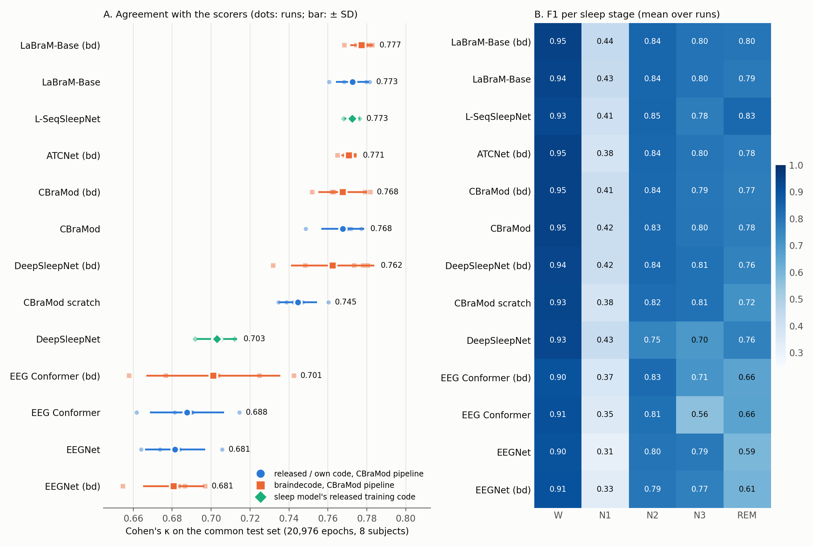

# CBraMod on Sleep-EDF, and the sleep-staging pipeline every model shares

Sleep staging on Sleep-EDF Expanded (Sleep Cassette: 78 subjects, 153 nights, 5 AASM stages) with CBraMod's released
sleep-staging code (its ISRUC path). This experiment holds the CBraMod runs: fine-tuned from the released weights,
and trained from random initialisation, 5 seeds each. It also holds the code every Sleep-EDF experiment shares:
preprocessing, subject split, pipeline, encoders, collection and the common test set.

Every other model runs through the same pipeline: its encoder replaces CBraMod's backbone, and the rest is the
released sequence model and trainer. The data, subject split, seeds (0–4), optimizer, schedule, checkpoint rule and
metric code are the same for every model, and each model's runs sit in that model's own experiment. The two sleep
models also train with their own released code on the same split:

| Model | Experiment | Implementation | Training |
|---|---|---|---|
| CBraMod (pre-trained, and no pre-training) | this experiment | released code and weights | CBraMod pipeline, 5 seeds |
| LaBraM-Base | [labram/sleepedf-cbramod-pipeline](../../../labram/experiments/sleepedf-cbramod-pipeline) | released code and weights | CBraMod pipeline, 5 seeds |
| EEG Conformer | [eeg-conformer/sleepedf-cbramod-pipeline](../../../eeg-conformer/experiments/sleepedf-cbramod-pipeline) | released model | CBraMod pipeline, 5 seeds |
| EEGNet | [eegnet/sleepedf-cbramod-pipeline](../../../eegnet/experiments/sleepedf-cbramod-pipeline) | our PyTorch EEGNet-8,2 | CBraMod pipeline, 5 seeds |
| ATCNet | [atcnet/braindecode-sleepedf](../../../atcnet/experiments/braindecode-sleepedf) | braindecode (released code is TensorFlow) | CBraMod pipeline, 5 seeds |
| DeepSleepNet | [deepsleepnet/braindecode-sleepedf](../../../deepsleepnet/experiments/braindecode-sleepedf) | braindecode (single-epoch) | CBraMod pipeline, 5 seeds |
| DeepSleepNet | [deepsleepnet/sleepedf78-cbramod-split](../../../deepsleepnet/experiments/sleepedf78-cbramod-split) | released code (TF 1.15) | its own training, 3 runs |
| L-SeqSleepNet | [l-seqsleepnet/sleepedf78-cbramod-split](../../../l-seqsleepnet/experiments/sleepedf78-cbramod-split) | released code (TF 1.15) | its own training, 3 runs |
| CBraMod, LaBraM-Base, EEG Conformer, EEGNet | [cbramod](../braindecode-sleepedf), [labram](../../../labram/experiments/braindecode-sleepedf), [eeg-conformer](../../../eeg-conformer/experiments/braindecode-sleepedf), [eegnet](../../../eegnet/experiments/braindecode-sleepedf) `/braindecode-sleepedf` | braindecode 1.8.1 | CBraMod pipeline, 5 seeds |

**CBraMod's paper reports no Sleep-EDF result.** Its sleep benchmark is ISRUC, and EEG Conformer, ATCNet, LaBraM and
EEGNet evaluate no sleep data. So the pipeline experiments compare models under identical conditions; they do not
reproduce published numbers. The two sleep models' papers report Sleep-EDF-20, reproduced in
[deepsleepnet/sleepedf20-20fold](../../../deepsleepnet/experiments/sleepedf20-20fold) and
[l-seqsleepnet/sleepedf20-loso](../../../l-seqsleepnet/experiments/sleepedf20-loso).

## Results

### CBraMod

Test set of the 8 test subjects (21,080 epochs, inside complete 20-epoch sequences), scored at the epoch with the
best validation κ (the released rule). Mean ± SD over seeds 0–4 (`results/results.txt`).

| | Balanced acc. | Cohen's κ | Weighted F1 | Accuracy | Macro-F1 |
|---|---|---|---|---|---|
| CBraMod, fine-tuned from the released weights | 0.7536 ± 0.0088 | 0.7676 ± 0.0109 | 0.8300 ± 0.0080 | 0.8350 ± 0.0081 | 0.7533 ± 0.0097 |
| CBraMod, no pre-training | 0.7317 ± 0.0155 | 0.7449 ± 0.0098 | 0.8134 ± 0.0094 | 0.8196 ± 0.0065 | 0.7344 ± 0.0151 |
| Pre-trained − no pre-training (Welch p) | +0.0219 (p = 0.031) | +0.0227 (p = 0.009) | | | +0.0189 (p = 0.053) |

| Per-stage F1 | W | N1 | N2 | N3 | REM |
|---|---|---|---|---|---|
| CBraMod | 0.9461 | 0.4155 | 0.8345 | 0.7949 | 0.7753 |
| CBraMod, no pre-training | 0.9350 | 0.3839 | 0.8227 | 0.8123 | 0.7182 |

- **Pre-training helps on Sleep-EDF**, by 0.023 κ (p = 0.009) and 0.022 balanced accuracy (p = 0.031). Of
  CBraMod's four public datasets it helped only on PhysioNet-MI
  ([finetune-public-datasets](../finetune-public-datasets)). Most of the gain is in REM (+0.057 F1) and N1 (+0.032);
  N3 is the one stage where the randomly initialised model is better (−0.017).
- **Validation selection is close to the best test epoch.** The best test epoch would add 0.0107 κ (pre-trained)
  and 0.0135 (no pre-training). The last epoch scores 0.7630 and 0.7469. The selected epochs are 12–25 of 50.

### All models, on the common test set

Every Sleep-EDF model is scored on the same 20,976 test epochs: the pipeline's test epochs minus each night's last
n mod 25, which DeepSleepNet's released `predict.py` drops (`results/test_epochs.json`, `code/epoch_keys.py`). The
pipeline models are scored over seeds 0–4, the two released sleep models over 3 runs
(`python ../../../../tools/compare_sleepedf.py --figure results/fig_sleepedf.png`).

<!-- COMMON (python tools/compare_sleepedf.py) -->
| Model | Implementation | Training | Runs | bal. acc | κ | macro F1 | accuracy | weighted F1 |
|---|---|---|---|---|---|---|---|---|
| LaBraM-Base | braindecode | CBraMod pipeline | 5 | 0.7670 ± 0.0105 | 0.7773 ± 0.0058 | 0.7668 ± 0.0062 | 0.8411 ± 0.0043 | 0.8380 ± 0.0037 |
| LaBraM-Base | released | CBraMod pipeline | 5 | 0.7612 ± 0.0184 | 0.7727 ± 0.0085 | 0.7619 ± 0.0153 | 0.8381 ± 0.0056 | 0.8343 ± 0.0089 |
| L-SeqSleepNet | released (TF 1.15) | own released code | 3 | 0.7558 ± 0.0182 | 0.7725 ± 0.0040 | 0.7583 ± 0.0096 | 0.8387 ± 0.0024 | 0.8314 ± 0.0042 |
| ATCNet | braindecode | CBraMod pipeline | 5 | 0.7430 ± 0.0078 | 0.7709 ± 0.0039 | 0.7496 ± 0.0053 | 0.8383 ± 0.0026 | 0.8295 ± 0.0032 |
| CBraMod | braindecode | CBraMod pipeline | 5 | 0.7393 ± 0.0183 | 0.7677 ± 0.0126 | 0.7530 ± 0.0117 | 0.8364 ± 0.0087 | 0.8298 ± 0.0082 |
| CBraMod | released | CBraMod pipeline | 5 | 0.7537 ± 0.0087 | 0.7676 ± 0.0110 | 0.7536 ± 0.0098 | 0.8348 ± 0.0082 | 0.8298 ± 0.0081 |
| DeepSleepNet | braindecode | CBraMod pipeline | 5 | 0.7666 ± 0.0053 | 0.7625 ± 0.0214 | 0.7522 ± 0.0158 | 0.8291 ± 0.0171 | 0.8258 ± 0.0152 |
| CBraMod, no pre-training | released | CBraMod pipeline | 5 | 0.7316 ± 0.0155 | 0.7446 ± 0.0099 | 0.7344 ± 0.0152 | 0.8193 ± 0.0066 | 0.8130 ± 0.0095 |
| DeepSleepNet | released (TF 1.15) | own released code | 3 | 0.7247 ± 0.0104 | 0.7030 ± 0.0103 | 0.7140 ± 0.0121 | 0.7841 ± 0.0080 | 0.7895 ± 0.0079 |
| EEG Conformer | braindecode | CBraMod pipeline | 5 | 0.6799 ± 0.0303 | 0.7011 ± 0.0345 | 0.6917 ± 0.0326 | 0.7875 ± 0.0256 | 0.7838 ± 0.0246 |
| EEG Conformer | released | CBraMod pipeline | 5 | 0.6448 ± 0.0267 | 0.6876 ± 0.0190 | 0.6585 ± 0.0235 | 0.7800 ± 0.0132 | 0.7706 ± 0.0128 |
| EEGNet | ours (PyTorch) | CBraMod pipeline | 5 | 0.6852 ± 0.0137 | 0.6815 ± 0.0154 | 0.6785 ± 0.0073 | 0.7719 ± 0.0126 | 0.7689 ± 0.0086 |
| EEGNet | braindecode | CBraMod pipeline | 5 | 0.6866 ± 0.0162 | 0.6808 ± 0.0157 | 0.6817 ± 0.0117 | 0.7708 ± 0.0120 | 0.7713 ± 0.0091 |

Per-stage F1 (mean over runs)

| Model | Implementation | W | N1 | N2 | N3 | REM |
|---|---|---|---|---|---|---|
| LaBraM-Base | braindecode | 0.9452 | 0.4419 | 0.8428 | 0.8040 | 0.8001 |
| LaBraM-Base | released | 0.9410 | 0.4345 | 0.8440 | 0.8049 | 0.7851 |
| L-SeqSleepNet | released (TF 1.15) | 0.9287 | 0.4057 | 0.8467 | 0.7761 | 0.8343 |
| ATCNet | braindecode | 0.9457 | 0.3829 | 0.8417 | 0.7982 | 0.7794 |
| CBraMod | braindecode | 0.9454 | 0.4145 | 0.8369 | 0.7942 | 0.7737 |
| CBraMod | released | 0.9460 | 0.4157 | 0.8348 | 0.7954 | 0.7758 |
| DeepSleepNet | braindecode | 0.9365 | 0.4192 | 0.8355 | 0.8098 | 0.7599 |
| CBraMod, no pre-training | released | 0.9347 | 0.3837 | 0.8228 | 0.8123 | 0.7186 |
| DeepSleepNet | released (TF 1.15) | 0.9308 | 0.4268 | 0.7518 | 0.6970 | 0.7638 |
| EEG Conformer | braindecode | 0.8987 | 0.3670 | 0.8274 | 0.7064 | 0.6588 |
| EEG Conformer | released | 0.9077 | 0.3471 | 0.8130 | 0.5616 | 0.6629 |
| EEGNet | ours (PyTorch) | 0.8998 | 0.3108 | 0.8013 | 0.7865 | 0.5942 |
| EEGNet | braindecode | 0.9059 | 0.3330 | 0.7944 | 0.7685 | 0.6068 |

pre-training: A − B, mean over runs, Welch p

| A − B | bal. acc | κ | macro F1 |
|---|---|---|---|
| CBraMod − CBraMod scratch | +0.0221 (p = 0.030) | +0.0230 (p = 0.009) | +0.0191 (p = 0.050) |
| LaBraM-Base − CBraMod scratch | +0.0296 (p = 0.026) | +0.0281 (p = 0.001) | +0.0275 (p = 0.021) |

foundation models: A − B, mean over runs, Welch p

| A − B | bal. acc | κ | macro F1 |
|---|---|---|---|
| LaBraM-Base − CBraMod | +0.0075 (p = 0.443) | +0.0051 (p = 0.435) | +0.0083 (p = 0.338) |

sleep models vs. foundation models: A − B, mean over runs, Welch p

| A − B | bal. acc | κ | macro F1 |
|---|---|---|---|
| L-SeqSleepNet − CBraMod | +0.0021 (p = 0.864) | +0.0049 (p = 0.404) | +0.0048 (p = 0.534) |
| L-SeqSleepNet − LaBraM-Base | -0.0054 (p = 0.704) | -0.0002 (p = 0.964) | -0.0036 (p = 0.699) |
| DeepSleepNet (bd) − CBraMod | +0.0129 (p = 0.027) | -0.0051 (p = 0.652) | -0.0014 (p = 0.875) |

sleep models: A − B, mean over runs, Welch p

| A − B | bal. acc | κ | macro F1 |
|---|---|---|---|
| L-SeqSleepNet − DeepSleepNet | +0.0311 (p = 0.078) | +0.0695 (p = 0.003) | +0.0443 (p = 0.009) |
| DeepSleepNet (bd) − DeepSleepNet | +0.0418 (p = 0.011) | +0.0595 (p = 0.002) | +0.0382 (p = 0.010) |

task-agnostic supervised models vs. CBraMod: A − B, mean over runs, Welch p

| A − B | bal. acc | κ | macro F1 |
|---|---|---|---|
| CBraMod − ATCNet (bd) | +0.0107 (p = 0.076) | -0.0033 (p = 0.556) | +0.0040 (p = 0.454) |
| CBraMod − EEGNet | +0.0684 (p < 0.001) | +0.0861 (p < 0.001) | +0.0750 (p < 0.001) |
| CBraMod − EEG Conformer | +0.1089 (p < 0.001) | +0.0800 (p < 0.001) | +0.0951 (p < 0.001) |

braindecode − original implementation, same pipeline: A − B, mean over runs, Welch p

| A − B | bal. acc | κ | macro F1 |
|---|---|---|---|
| CBraMod (bd) − CBraMod | -0.0144 (p = 0.166) | +0.0001 (p = 0.991) | -0.0006 (p = 0.933) |
| LaBraM-Base (bd) − LaBraM-Base | +0.0059 (p = 0.559) | +0.0046 (p = 0.356) | +0.0049 (p = 0.532) |
| EEG Conformer (bd) − EEG Conformer | +0.0350 (p = 0.089) | +0.0135 (p = 0.470) | +0.0332 (p = 0.105) |
| EEGNet (bd) − EEGNet | +0.0013 (p = 0.894) | -0.0007 (p = 0.947) | +0.0032 (p = 0.621) |
<!-- /COMMON -->



## The pipeline

CBraMod's released sleep-staging model (`upstream/models/model_for_isruc.py`) classifies sequences of 20 consecutive
30-s epochs: each epoch goes through the backbone, the flattened epoch features through Linear(→ 512) + GELU, one
Transformer encoder layer (4 heads) runs across the 20 epochs, and a linear layer classifies every epoch. Its trainer
(`finetune_trainer.py`, ISRUC branch) uses cross-entropy with label smoothing 0.1, AdamW, a cosine schedule, and
keeps the epoch with the best validation κ; the test set is scored once, with balanced accuracy, κ and weighted F1.

Here the backbone is swapped for each model's own encoder (`code/seq_models.py`), and everything after it (head,
sequence encoder, classifier, trainer, evaluator) is the released code. Each encoder returns what its own model feeds
its own classifier:

| Model | Implementation | Encoder output per 30-s epoch | Encoder parameters | Learning rate (multi_lr) |
|---|---|---|---|---|
| CBraMod | released code and weights (`pretrained_weights.pth`, md5 355de9c3…) | backbone with `proj_out` removed, as `model_for_isruc`: 2 channels × 30 patches × 200 | 4,883,800 | backbone 1e-4, rest 5e-4 |
| CBraMod, no pre-training | released code, random init | same | 4,883,800 | same |
| LaBraM-Base | released code and weights (`labram-base.pth`) | mean-pooled tokens after `fc_norm` (LaBraM's own classifier input), per 15-s half, concatenated: 2 × 200 | 5,819,936 | backbone 1e-4, rest 5e-4 |
| EEG Conformer | released model (`conformer.py`, copied in `code/conformer_released.py`) | convolution + 6 attention blocks, flattened tokens: 394 × 40 | 124,320 | 5e-4 |
| EEGNet | our PyTorch EEGNet-8,2 (as in [eegnet/pytorch-cbramod-splits](../../../eegnet/experiments/pytorch-cbramod-splits)) | flattened block-2 output: 16 × 187 | 1,424 | 5e-4 |
| CBraMod | braindecode `CBraMod`, its pre-trained weights | `return_features` output (braindecode keeps `proj_out`) | 4,924,000 | backbone 1e-4, rest 5e-4 |
| LaBraM-Base | braindecode `Labram`, its pre-trained weights | as released (two halves) | 5,819,936 | backbone 1e-4, rest 5e-4 |
| EEG Conformer | braindecode `EEGConformer` | `return_features` output, flattened: 394 × 40 | 124,320 | 5e-4 |
| ATCNet | braindecode `ATCNet` (defaults) | the five sliding windows' TCN outputs, concatenated: 5 × 32 | 112,432 | 5e-4 |
| DeepSleepNet | braindecode `DeepSleepNet`, first-layer kernels and strides given for 200 Hz | its two CNN paths, its BiLSTM over a sequence of length 1 and the residual shortcut: 1,024 | 40,497,152 | 5e-4 |
| EEGNet | braindecode `EEGNet` (F1 8, D 2, kernel 100) | flattened output before its final layer | 1,424 | 5e-4 |

The released head adds 3.2–11.2M parameters: the Transformer layer across the 20 epochs (3.2M) and the Linear from
the encoder output to 512 dimensions (0.1M for ATCNet to 8.1M for EEG Conformer). The foundation models' encoders are named `backbone`, so the released `multi_lr` gives them 1e-4 and
the head 5e-4; the supervised models train at 5e-4 throughout, as EEGNet did in CBraMod's pipeline before.

## Data

| | |
|---|---|
| Recordings | Sleep-EDF Expanded 1.0.0 (PhysioNet `sleep-edfx`), Sleep Cassette study: 153 nights of 78 healthy subjects aged 25–101 (75 with two nights), hypnograms scored by technicians (Rechtschaffen & Kales) |
| Channels | EEG Fpz-Cz and Pz-Oz (100 Hz in the files) |
| Preprocessing (`code/preprocess_sleepedf.py`) | resampled to 200 Hz; FIR band-pass 0.3–35 Hz as CBraMod's ISRUC script; 30-s epochs aligned to the hypnogram; stages W / N1 / N2 / N3 (= S3 + S4) / REM; movement and unscored epochs dropped; only the sleep period plus 30 min of wake on each side kept; non-overlapping sequences of 20 consecutive scored epochs (remainders dropped) |
| Size | 192,840 epochs in 9,642 sequences (195,767 in the kept windows; 298 unscored or movement epochs) |
| Subject split | age-stratified, fixed: subjects sorted by age, in blocks of 10 one to validation and one to test (RNG seed 0); 62 / 8 / 8 subjects, a subject's nights together. Train 7,655 sequences, validation 933, test 1,054. Ages 25–96 / 26–101 / 27–97 |
| Stage counts (train / val / test) | W 50,968 / 5,223 / 8,347 · N1 17,384 / 2,093 / 1,950 · N2 54,966 / 6,928 / 6,729 · N3 9,951 / 1,355 / 1,558 · REM 19,831 / 3,061 / 2,496 |

The subject lists are in `results/split.json`, the per-night counts in `results/data_stats.json`.

## Paper vs. this experiment

### What differs from CBraMod's released ISRUC pipeline, and why

| | CBraMod's ISRUC code | This experiment | Why |
|---|---|---|---|
| Dataset | ISRUC group 1, 100 subjects, 6 EEG derivations at 200 Hz | Sleep-EDF Sleep Cassette, 78 subjects, Fpz-Cz and Pz-Oz at 100 Hz, resampled to 200 Hz | the dataset of this experiment; CBraMod and LaBraM embed 200-sample (1-s) patches |
| Filtering | FIR 0.3–35 Hz, 50 Hz notch | FIR 0.3–35 Hz after resampling; no notch | the files hold no content above their 50 Hz Nyquist limit, and the low-pass is at 35 Hz |
| Labels | AASM stages as scored | R&K stages mapped to AASM (S3 + S4 → N3); movement / unscored epochs dropped | Sleep-EDF is scored with R&K |
| Recording length | whole recordings | sleep period ± 30 min of wake | Sleep Cassette files cover ~20 h, mostly wake; the usual Sleep-EDF practice (DeepSleepNet's `prepare_physionet.py` and most later work) |
| Subject split | index 1–80 / 81–90 / 91–100 | age-stratified 62 / 8 / 8 (`split.json`) | Sleep-EDF subject IDs follow age (IDs 0–19 average 29 years, 60–77 average 90): an index split would test only on the oldest subjects |
| File pairing | zips two unsorted `os.listdir()` results | sorted file lists, checked to match | the released pairing depends on directory order |
| Batch | 64 sequences | 64 sequences, accumulated from micro-batches (Conformer 16 × 4; the foundation models, braindecode's Conformer and DeepSleepNet 2 × 32; the others 1 × 64); an incomplete last batch is dropped | 12 GB GPUs; for models without BatchNorm the update is the released one |
| Test scoring | once, at the selected epoch | also after every epoch, recorded in `metrics.json` and never used for training or selection | measures how much test-set epoch selection would add (Results) |
| Checkpoints | saved | not saved; the selected epoch's test predictions are (`test_preds.npz`) | every number recomputes without a GPU |
| Loader workers | 0 | 4 | speed only |

Every changed line of the copied CBraMod code is marked `# [MOD]` (`code/sleepedf_dataset.py`, `code/seq_trainer.py`).

### Settings we had to choose

| Setting | Value | Why |
|---|---|---|
| Models other than CBraMod | encoder in place of CBraMod's backbone; the released head, sequence encoder and trainer unchanged | only the model differs, as for EEGNet in [eegnet/pytorch-cbramod-splits](../../../eegnet/experiments/pytorch-cbramod-splits); a model without the sequence context would be judged on a different task |
| Encoder features | each model's own classifier input (table above) | the representation each model was designed to classify from |
| LaBraM on 30-s epochs | two 15-s halves, each through LaBraM (time positions 0–14), pooled features concatenated | LaBraM's pre-trained time embedding has 16 positions; splitting keeps the weights unchanged, where interpolating or extending the embedding would alter them |
| LaBraM's channel names | Fpz-Cz → FPZ, Pz-Oz → PZ (the active electrode) | its electrode embedding has no bipolar derivations |
| LaBraM's optimizer | CBraMod's trainer (AdamW, backbone 1e-4), not LaBraM's own recipe (layer decay, warm-up) | one trainer for all models; LaBraM's script has no sequence mode |
| ATCNet | braindecode's `ATCNet` only | the released code is TensorFlow; braindecode's network has the released layers and weights (`../../../atcnet/experiments/braindecode-bciciv2a`), and its one consequential difference, the final layer's max-norm axis, is in the layer the head replaces here |
| DeepSleepNet | braindecode's `DeepSleepNet` (single-epoch: its BiLSTM sees one epoch), first-layer kernel and stride given for 200 Hz (small path 100 / 12, large path 800 / 100) so every later feature map has the original size | braindecode's defaults are the 100 Hz values; the released TensorFlow code, a sequence model of its own (25-epoch BiLSTM), runs on the same split in [deepsleepnet/sleepedf78-cbramod-split](../../../deepsleepnet/experiments/sleepedf78-cbramod-split) |
| Hyper-parameters | `finetune_main.py` defaults (CBraMod Table 6) for every model; no tuning | one untuned recipe per model, as in the other CBraMod-pipeline experiments |
| Seeds | 0–4 | as in every other CBraMod-pipeline experiment |

### Run configuration

`finetune_main.py` defaults: 50 epochs, batch 64 sequences, AdamW (weight decay 5e-2), lr 1e-4 for the backbone and
0.001 × √(64 / 256) = 5e-4 for everything else, cosine annealing per optimizer step to 1e-6, gradient-norm clipping
1, label smoothing 0.1, dropout as in each model. Seeds via `finetune_main.setup_seed()` (`cudnn.deterministic`).
Environment: the `bd-labram` conda env (Python 3.11, PyTorch 2.1.2 + CUDA 11.8, braindecode 1.8.1, timm 0.4.12,
MNE 1.12.1; `env/pip_freeze.txt`). Hardware: 8× Quadro M6000 12 GB, one run per GPU.

## Layout

```
code/preprocess_sleepedf.py   Sleep-EDF -> ISRUC-format sequences + split.json (needs MNE)
code/sleepedf_dataset.py      CBraMod's isruc_dataset.py with Sleep-EDF paths and split ([MOD])
code/seq_trainer.py           CBraMod's Trainer (ISRUC path) + gradient accumulation, per-epoch test log ([MOD])
code/seq_models.py            the eleven encoders and the released sequence model around them
code/conformer_released.py    EEG Conformer's model classes, copied from conformer.py (GPL-3.0)
code/run_seq.py               one run: finetune_main.py defaults, a model name and a seed
code/smoke_test.py            parameter counts and the largest micro-batch per model
code/add_jobs.py              enqueue runs for tools/run_queue.py
code/collect.py               every number of a pipeline experiment from its logs/runs/*/{metrics.json,test_preds.npz}
code/export_summary.py        results/summary.csv of a pipeline experiment (feeds the repo-wide RESULTS.md)
code/epoch_keys.py            which epochs each experiment scores; writes results/test_epochs.json (common test set)
code/split_metrics.py         scoring of the sleep models' released-code runs on the common test set
logs/runs/<run>/              log.txt (progress bars removed), metrics.json, test_preds.npz for the 10 CBraMod runs
results/                      results.txt, results.json, summary.csv, fig_sleepedf.png (all models,
                              tools/compare_sleepedf.py), split.json, data_stats.json, test_epochs.json,
                              sc_subjects.json (age / sex per subject, from PhysioNet's SC-subjects.xls)
env/pip_freeze.txt            packages of the runs
```

## Reproducing

From the committed runs, without a GPU (numpy, scipy, scikit-learn, matplotlib):

```bash
mkdir -p results_rerun && python code/collect.py logs/runs results_rerun > results_rerun/results.txt \
  && diff results_rerun/results.txt results/results.txt
python ../../../../tools/compare_sleepedf.py           # all models on the common test set
```

Every other pipeline experiment has `code/reproduce.sh collect` (the same `collect.py` on its own runs) and
`code/reproduce.sh train`.

Re-running training (Linux, one 12 GB GPU per run). The 55 runs took ≈ 440 GPU-hours on Quadro M6000s; per run:
ATCNet ≈ 24 h, EEG Conformer (either implementation) ≈ 13 h, CBraMod (either) ≈ 8.6 h, LaBraM (either) ≈ 4.6 h,
DeepSleepNet ≈ 50 min, EEGNet ≈ 45 min.

```bash
datasets/download.sh sleepedf                                   # 7.1 GB -> $EEG_DATA_ROOT/sleep_edfx
python code/preprocess_sleepedf.py                              # -> $EEG_DATA_ROOT/sleep_edfx/processed_seq20 (8.7 GB)
python code/epoch_keys.py                                       # results/test_epochs.json (hypnograms only)
for m in conformer cbramod cbramod-scratch labram bd-atcnet eegnet bd-deepsleepnet \
         bd-conformer bd-cbramod bd-labram bd-eegnet; do python code/add_jobs.py $m 0 1 2 3 4; done
RUN_QUEUE_DIR=~/repro-sleepedf/queue python ../../../../tools/run_queue.py 0 1 2 3 4 5 6 7
python code/collect.py ~/repro-sleepedf/runs results_rerun > results_rerun/results.txt   # all runs in one table
```

`CBRAMOD_WEIGHTS` points to CBraMod's released `pretrained_weights.pth` (Hugging Face `weighting666/CBraMod`);
LaBraM's weights ship in `methods/labram/upstream/checkpoints`; braindecode's are downloaded from Hugging Face at
pinned revisions.

## Provenance

Runs: 2026-10-29 to 2026-11-01 on mcl-server, `~/repro-sleepedf`. License: `code/conformer_released.py` copies
GPL-3.0 code; `code/sleepedf_dataset.py` and `code/seq_trainer.py` copy MIT code (CBraMod).
