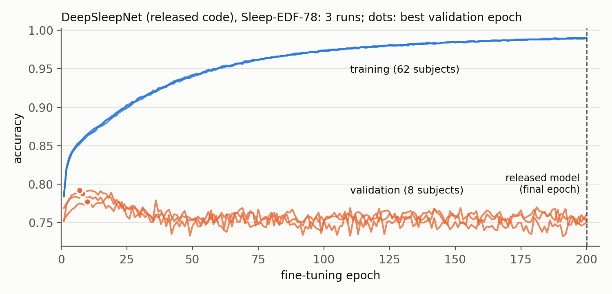

# DeepSleepNet on Sleep-EDF-78, on the subject split of the CBraMod-pipeline experiments

How does DeepSleepNet, trained with its own released code, compare with the other models on the same 62 / 8 / 8
subjects and the same test epochs? The released `train.py` (100 pre-training + 200 fine-tuning epochs, final model)
trains on the 62 training subjects of [cbramod/finetune-sleepedf](../../../cbramod/experiments/finetune-sleepedf)
(`results/split.json`). The released `predict.py` then scores its 8 test subjects. 3 runs.

The paper reports Sleep-EDF-20 only (reproduced in [sleepedf20-20fold](../sleepedf20-20fold)). No published number
exists for this split.

## Results

The common test set holds the 20,976 test epochs every Sleep-EDF model scores. Values are mean ± SD over 3 runs.

| Metric | DeepSleepNet | per run |
|---|---|---|
| Balanced accuracy | 0.7247 ± 0.0104 | 0.7333 0.7132 0.7277 |
| Cohen's κ | 0.7030 ± 0.0103 | 0.7121 0.6917 0.7051 |
| Weighted F1 | 0.7895 ± 0.0079 | 0.7965 0.7809 0.7910 |
| Accuracy | 0.7841 ± 0.0080 | 0.7914 0.7756 0.7854 |
| Macro-F1 | 0.7140 ± 0.0121 | 0.7257 0.7016 0.7147 |

Per-stage F1 is W 0.9308, N1 0.4268, N2 0.7518, N3 0.6970 and REM 0.7638. On all 21,125 epochs `predict.py` scores,
κ is 0.7033 ± 0.0102.

**The released DeepSleepNet is the weakest of the sequence models on this split** (`python tools/compare_sleepedf.py`):

- It trails L-SeqSleepNet by 0.0695 κ (p = 0.003) and the foundation models by about 0.07.
- It trails braindecode's DeepSleepNet trained in CBraMod's pipeline by 0.0595 κ (p = 0.002):
  [braindecode-sleepedf](../braindecode-sleepedf), single-epoch CNN + BiLSTM, with CBraMod's sequence Transformer on
  top and the epoch chosen by validation κ.
- Its N2 F1 (0.75) is the lowest of all models (the others score ≥ 0.79). Its N3 F1 (0.70) is below every model
  except EEG Conformer (0.56). Both are below its own Sleep-EDF-20 result (0.85, 0.84).

**The final-model rule costs it here.** The released code prints the validation set every epoch but never uses
it, and the last fine-tuning epoch is the model. On this split, validation accuracy peaks at fine-tuning epoch 7–10
(0.777–0.792) and falls to 0.750–0.761 by epoch 200. By then training accuracy is 0.99 and validation loss has
tripled (about 20 to 60): the model overfits after a few fine-tuning epochs. The 200 fine-tuning epochs were set for
Sleep-EDF-20 and MASS, and this training set is about 3.5 times Sleep-EDF-20's.

| Run | Best validation acc. (fine-tuning epoch) | Validation acc. at epoch 200 | Training acc. at epoch 200 |
|---|---|---|---|
| 0 | 0.788 (8) | 0.750 | 0.990 |
| 1 | 0.792 (7) | 0.761 | 0.989 |
| 2 | 0.777 (10) | 0.751 | 0.990 |

(`python code/plot_curves.py`, from `logs/runs/run<r>/train.txt`: `results/curves.txt`)



## Paper vs. this reproduction

### What differs, and why

| | Paper / released code | This experiment | Why |
|---|---|---|---|
| Data | Sleep-EDF-20, `prepare_physionet.py` | all 153 Sleep-EDF-78 nights, in `prepare_physionet.py`'s format, written by `code/prepare_split_data.py` | the released script stops at SC4362F0: that night's hypnogram scores 18,420 s past the end of the recording, the label trimming removes every epoch and `np.split` fails. 82 of the 153 nights are left unwritten. On the nights it does write, the port's files are identical (signal and labels; checked with `prepare_split_data.py check`) |
| Epochs kept | sleep period ± 30 min (`prepare_physionet.py`) | the same rule, through the CBraMod pipeline's preprocessing (`keys.json` records each night's epochs) | every model scored on the same epochs |
| Split | 20-fold CV, the held-out subject chosen by a file-name regex on `--fold_idx` | training = the 62 training subjects' nights, "validation" = the 8 validation subjects' nights (`code/train_split.py`, `[MOD]` in `load_train_data()` only) | the comparison split; the regex only knows the E0/J0 night codes and one held-out subject |
| Prediction | `predict.py`, one model per fold | `code/predict_split.py`: `predict()` unchanged, one model for the 8 test subjects (`[MOD]` in `load_subject_data()` only) | the comparison split |
| Runs | 1 cross-validation | 3 runs | an SD over runs; the released code sets no seed |

### Settings we had to choose

| Setting | Value | Why |
|---|---|---|
| Model selection | none: the final model (released) | as released; the validation set is only printed, as in the released 20-fold runs |
| Training length | 100 + 200 epochs (released defaults) | as released, although the training set is larger |
| Channel | Fpz-Cz, 100 Hz, unfiltered (as `prepare_physionet.py`) | as released |
| Common test set | the CBraMod-pipeline test epochs minus each night's last n mod 25, which `predict.py` drops | the epochs every model scores (`epoch_keys.py` of the CBraMod experiment) |

### Run configuration

`train.py` flags: `--n_folds 20 --fold_idx 0 --pretrain_epochs 100 --finetune_epochs 200 --resume False` (the fold
flags only name the output directory here). About 5.3 h per run on one Quadro M6000 12 GB. Environment: conda env
`tf115` (TensorFlow 1.15.0 GPU, Python 3.7.12; `env/conda_list.txt`).

## Layout

```
code/prepare_split_data.py   153 nights in prepare_physionet.py's format + keys.json (needs MNE)
code/train_split.py          the released train.py with the split's file lists ([MOD])
code/predict_split.py        the released predict.py for the 8 test subjects ([MOD])
code/add_jobs.py             enqueue one run per job (tools/run_queue.py)
code/collect.py              every number above from logs/preds
code/plot_curves.py          training / validation curves from logs/runs (results/curves.txt, fig_curves.png)
code/export_summary.py       results/summary.csv (feeds RESULTS.md)
logs/runs/run<r>/            train.txt, predict.txt
logs/preds/                  run<r>/subject<i>.npz + subjects.json, keys.json
results/                     results.txt, results.json, summary.csv, curves.txt, fig_curves.png
env/conda_list.txt           packages of the runs
```

## Reproducing

From the committed predictions (numpy, scikit-learn):

```bash
mkdir -p results_rerun && python code/collect.py logs/preds results_rerun > results_rerun/results.txt \
  && diff results_rerun/results.txt results/results.txt
python code/plot_curves.py logs/runs results_rerun && diff results_rerun/curves.txt results/curves.txt
```

Training (Linux, TF 1.15 env):

```bash
python code/prepare_split_data.py                     # -> $DSN_DATA78 (~/repro-sleepmodels/data/dsn_sc78)
python code/add_jobs.py 0 1 2
RUN_QUEUE_DIR=~/repro-sleepedf/queue python ../../../../tools/run_queue.py 0 1 2 3 4 5 6 7
for r in 0 1 2; do python ../sleepedf20-20fold/code/export_preds.py $DSN_WORK78/run$r/predict logs/preds/run$r; done
```

## Provenance

Runs: 2026-10-30 on mcl-server (`~/repro-sleepmodels/runs/dsn_sc78`), released code at `eb72f9b`.
`code/train_split.py`, `code/predict_split.py` copy functions of `deepsleep/data_loader.py` (Apache-2.0).
