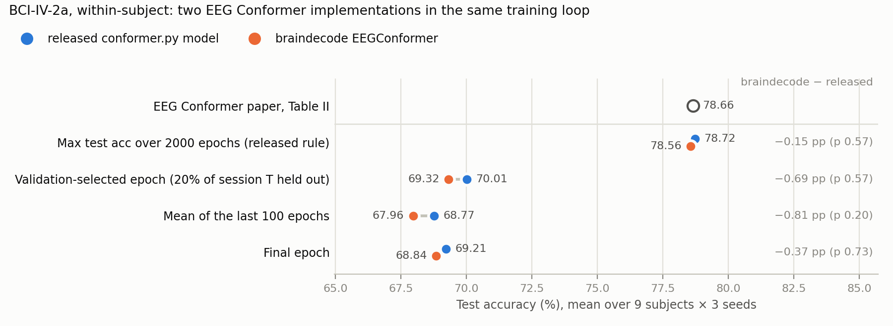

# EEG Conformer as implemented in braindecode (BCI IV 2a)

[bciciv2a-epoch-selection](../bciciv2a-epoch-selection) re-ran the released `conformer.py` on BCI IV 2a. This
experiment asks:

> Does braindecode's `EEGConformer`, trained by the same released loop, reproduce the released model's numbers?

It runs braindecode's `EEGConformer` ([braindecode](../../../eegnet/upstream) v1.8.1, the version pinned in
`methods/eegnet/upstream`) through EEG Conformer's released training loop. The loop is imported from
`../bciciv2a-epoch-selection/code/run_validation.py` and only the model is swapped, the way
[methods/eegnet/experiments/bciciv2a-epoch-selection](../../../eegnet/experiments/bciciv2a-epoch-selection) swaps in
EEGNet. Everything else matches the committed released-code runs: the same preprocessed data, z-scoring,
segmentation-and-recombination augmentation, batch 72, Adam (lr 2e-4, β 0.5 / 0.999), 2000 epochs, seeds 2023–2025
and the two protocols.

| Tag | Training data | Reported epoch | Runs |
|---|---|---|---|
| **A** | all 288 trials of session T | read from the per-epoch test curve: maximum (the released rule), last-100-epoch mean, final epoch, all-epoch mean | 9 subjects × 3 seeds = 27 |
| **B** | 80% of session T (20% held out) | epoch with the highest validation accuracy | 9 subjects × 3 seeds = 27 |

Building the model does not touch NumPy's random generator, so protocol B holds out the same validation trials as the
released-code run with the same (subject, seed).

## Is braindecode's EEGConformer the released model?

`code/check_equivalence.py` (output: `results/equivalence.txt`) copies the released model's weights into
braindecode's and compares the two forward passes:

- **Same layers, same shapes.** braindecode's 113 state-dict entries (parameters and BatchNorm buffers) match the
  released model's one to one, in the same order.
  The released classification head also builds a `clshead` branch (mean pooling → LayerNorm → Linear, 244 parameters)
  that its forward pass never uses. Without it the two models have the same 789,572 parameters (released: 789,816).
- **One difference in the forward pass: the attention temperature.** With identical weights the logits differ (max
  |difference| 8.6e-4 for 64 random inputs in float64; same predicted class). braindecode's `MultiHeadAttention` calls
  PyTorch's `scaled_dot_product_attention`, which divides the query–key products by √(head dimension) = √4 = 2.
  The released code divides by √(embedding size) = √40 ≈ 6.32. With the released scaling patched into braindecode's
  attention, the logits are identical (difference 0). braindecode's softmax is therefore √10 ≈ 3.2× sharper than
  the released model's, in all 6 layers.

The training runs below measure what that one difference does.

## Results

All 54 runs finished on 2026-10-22. Each cell is the grand mean over 9 subjects × 3 seeds, with κ computed from the
grand-mean accuracy (4 classes). braindecode − released is the mean of the 9 per-subject differences; p is from a
two-sided Wilcoxon signed-rank test over the 9 subjects, the test the paper uses.

| Reported epoch | braindecode, acc. % (κ) | released model, acc. % (κ) | braindecode − released | Subjects where braindecode is higher | Wilcoxon p | braindecode − paper (78.66) |
|---|---|---|---|---|---|---|
| **A**: maximum over 2000 test evaluations (released rule) | **78.56** (0.7142) | 78.72 (0.7162) | −0.15 pp | 3 / 9 | 0.57 | −0.10 pp |
| **A**: mean of the last 100 epochs | 67.96 (0.5728) | 68.77 (0.5836) | −0.81 pp | 3 / 9 | 0.20 | −10.71 pp |
| **A**: final epoch | 68.84 (0.5845) | 69.21 (0.5895) | −0.37 pp | 3 / 9 | 0.73 | −9.82 pp |
| **A**: mean over all 2000 epochs | 66.04 (0.5472) | 66.74 (0.5565) | −0.70 pp | 2 / 9 | 0.074 | −12.63 pp |
| **B**: validation-selected epoch | **69.32** (0.5909) | 70.01 (0.6001) | −0.69 pp | 5 / 9 | 0.57 | −9.35 pp |



- **braindecode's EEGConformer reproduces the released model.** Under the released rule it reaches 78.56%, against
  78.72% for the released model and 78.66% in the paper, and under every rule the two implementations are level
  (braindecode 0.15–0.81 pp lower, p ≥ 0.07, higher on 2–5 of 9 subjects). The 3.2× sharper attention
  softmax (above) makes no measurable difference with 27 runs per protocol.
- **The epoch-selection finding does not depend on the implementation.** braindecode's test accuracy fluctuates as
  much over the last 100 epochs (SD 5.71 pp per run, against 5.52), so the released rule inflates it just as much:
  the maximum is 10.61 pp above the last-100 mean (released model: 9.95) and 7.16 pp above the validation-selected
  epoch of the same protocol B run (6.91). A validation split gives 69.32%, 9.3 pp below the paper.
- **Neither does the comparison with EEGNet.** Run against the braindecode EEGNet of
  [methods/eegnet/experiments/bciciv2a-epoch-selection](../../../eegnet/experiments/bciciv2a-epoch-selection) (same
  loop), braindecode's Conformer leads significantly only under the released rule (+5.94 pp, 9 of 9 subjects,
  p = 0.0039; released model: +6.10 pp). At the last-100-epoch mean EEGNet is ahead (−1.57 pp, p = 0.36), and with a
  validation split Conformer's +1.95 pp is not significant (p = 0.43; released model: +2.65 pp, p = 0.16).

braindecode EEGConformer per subject, mean ± SD over the 3 seeds (accuracy, %):

| Subject | Paper | A: max over test evaluations | A: last-100 mean | A: final epoch | B: validation-selected |
|---|---|---|---|---|---|
| 1 | 88.19 | 90.28 ± 0.35 | 80.11 ± 1.21 | 85.42 ± 2.76 | 84.38 ± 2.28 |
| 2 | 61.46 | 59.26 ± 0.20 | 46.91 ± 0.75 | 47.22 ± 4.21 | 44.10 ± 7.76 |
| 3 | 93.40 | 93.29 ± 0.53 | 85.71 ± 1.10 | 87.96 ± 5.54 | 84.38 ± 2.11 |
| 4 | 78.13 | 79.28 ± 1.00 | 68.33 ± 1.02 | 66.32 ± 8.51 | 74.19 ± 3.61 |
| 5 | 52.08 | 54.98 ± 1.57 | 42.80 ± 1.76 | 42.36 ± 5.68 | 42.59 ± 2.00 |
| 6 | 65.28 | 62.38 ± 0.53 | 51.40 ± 0.99 | 51.74 ± 0.35 | 52.66 ± 2.12 |
| 7 | 92.36 | 91.67 ± 0.60 | 75.62 ± 0.67 | 77.78 ± 4.54 | 78.59 ± 2.83 |
| 8 | 88.19 | 87.50 ± 0.69 | 79.16 ± 2.46 | 80.79 ± 1.91 | 81.71 ± 1.12 |
| 9 | 88.89 | 88.43 ± 0.87 | 81.57 ± 0.85 | 79.98 ± 2.31 | 81.25 ± 1.39 |
| **Avg** | **78.66** | **78.56** | **67.96** | **68.84** | **69.32** |

How the test curve behaves (protocol A, epochs 0-based as `conformer.py` prints them):

| | braindecode | released model |
|---|---|---|
| SD of test accuracy over the last 100 epochs (pp per run, mean ± SD over 27 runs) | 5.71 ± 1.91 | 5.52 ± 1.70 |
| max − last-100 mean (pp per run) | 10.61 ± 2.86 | 9.95 ± 3.37 |
| training accuracy on the last batch of an epoch, mean of the last 100 epochs | 99.15% | 99.11% |
| median first epoch above 30% test accuracy | 8 | 7 |
| median first epoch within 1 pp of the last-100 mean | 71 | 72 |
| median epoch of the maximum (range) | 1689 (790–1972) | 1427 (468–1996) |
| runs whose maximum comes after epoch 1000 | 89% | 78% |
| seconds per epoch | 0.823 (Quadro M6000) | 0.567 (A40) |

All numbers are in `results/results.txt` and `results/results.json`, and the headline rows in `results/summary.csv`.

## Paper vs. this reproduction

### What differs, and why

| | Paper / released code | Released-code runs ([bciciv2a-epoch-selection](../bciciv2a-epoch-selection)) | This experiment | Why |
|---|---|---|---|---|
| Model code | `conformer.py` (`Conformer`) | copied verbatim into `run_validation.py` | braindecode 1.8.1 `EEGConformer` with its defaults (`n_chans=22, n_outputs=4, n_times=1000`) | the question of this experiment |
| Attention scaling | softmax(QKᵀ / √40) | same | softmax(QKᵀ / √4), PyTorch's `scaled_dot_product_attention` | braindecode's implementation; see above |
| Attention dropout | `nn.Dropout(0.5)` on the attention weights | same | `dropout_p=0.5` inside `scaled_dot_product_attention` | same operation; draws from the CUDA generator differently, so runs are not bit-comparable |
| Unused `clshead` branch | built, never used | same | not built | so the fully connected head's initial weights differ for the same seed (the generator is consumed differently) |
| Training loop, data, seeds, protocols | – | `run_validation.py` | imported unchanged from `run_validation.py` | only the model may differ |
| Hardware | RTX 3090 | NVIDIA A40 (USC CARC) | Quadro M6000 (mcl-server) | the hardware we had free; the EEGNet runs used the same GPUs |

### Settings we had to choose

| Setting | Value | Why |
|---|---|---|
| braindecode arguments | `EEGConformer(n_chans=22, n_outputs=4, n_times=1000)`, everything else default | braindecode's defaults are the released Dataset I settings (40 filters of 25 samples, pooling 75 / 15, depth 6, 10 heads, dropout 0.5, head 2440 → 256 → 32 → 4); a user loading the model gets these |
| Output | the logits feed the loop's cross-entropy; `EEGConformerForExP` returns them in place of the released model's (features, logits) pair | the features are never used by the loop |

### Run configuration

`code/run_braindecode.py` → `../bciciv2a-epoch-selection/code/run_validation.py` (`--epochs 2000`, `--val-frac 0.0`
for A and `0.2` for B, seeds 2023 / 2024 / 2025). `cudnn.deterministic = True`, `cudnn.benchmark = False`, as set by
the imported loop. Environment: the conda env of the EEGNet experiment, unchanged: Python 3.11.17, torch 2.6.0+cu124
(the released-code runs' version), braindecode 1.8.1 from `methods/eegnet/upstream`, numpy 2.4.6, scipy 1.17.1
(`env/setup_env.sh`, `env/pip_freeze.txt`). Hardware: mcl-server, one Quadro M6000 12 GB per run, 8 runs at a time
in a queue shared with the other braindecode experiments. The 54 runs took place on 2026-10-22, 01:15–09:15 UTC
(median 28.0 min per run in A, 26.8 min in B); all exited normally.

mcl-server's NVIDIA user-space libraries were upgraded to 580.178.04 on 2026-10-09 without a reboot, so the loaded
kernel module (580.173.02) no longer matches them and NVML fails to initialise. PyTorch's CUDA allocator calls NVML
while building its out-of-memory message, so when cuDNN tries a convolution workspace that does not fit (which it
normally catches before falling back to another algorithm) the run dies with `NVML_SUCCESS ==
DriverAPI::get()->nvmlInit_v2_() INTERNAL ASSERT FAILED`. Our first test run died that way in its first training
step, in the backward pass of a convolution. The queue was therefore started with `LD_LIBRARY_PATH` pointing to
`libnvidia-ml.so.580.173.02`, extracted from Ubuntu's `libnvidia-compute-580_580.173.02-0ubuntu0.24.04.1` package to
match the loaded module. NVML is only used for that error message and for monitoring; it does not touch the
computation.

## Layout

```
code/run_braindecode.py    imports the released loop and swaps its model for braindecode's EEGConformer
code/check_equivalence.py  released vs. braindecode model with the same weights -> results/equivalence.txt
code/add_jobs.py           queues the 54 runs for tools/run_queue.py
code/analyze.py            every table in this README -> results/results.txt, results/results.json
code/export_summary.py     results/summary.csv (feeds the repo-wide RESULTS.md)
code/make_figure.py        results/fig_braindecode_vs_released.png
env/                       setup_env.sh, pip_freeze.txt
results/curve_*.npz        per-epoch test / val / train accuracy for all 54 runs (same format as the released-code curves)
logs/runs/<tag>_s<subject>_seed<seed>.txt   console output of each run
logs/queue.log             start and end of every job
```

## Reproducing

From the committed curves, with no GPU (numpy, scipy, matplotlib). `analyze.py` also reads the released-code curves
from `../bciciv2a-epoch-selection/results`:

```bash
mkdir -p results_rerun
python code/analyze.py results > results_rerun/results.txt
diff results_rerun/results.txt results/results.txt
python code/make_figure.py results
python code/export_summary.py results
python code/check_equivalence.py > results_rerun/equivalence.txt   # needs torch, einops and braindecode; CPU only
```

Re-running the training on a Linux GPU server (about 28 min per run on a Quadro M6000):

```bash
git clone --recurse-submodules https://github.com/woo0kim/eeg-analysis-methods-review
cd eeg-analysis-methods-review/methods/eeg-conformer/experiments/braindecode-bciciv2a
bash env/setup_env.sh
../../../../datasets/download.sh bciciv2a
mkdir -p ~/repro-braindecode/conformer
~/miniforge3/envs/eegnet/bin/python ../bciciv2a-epoch-selection/code/preprocess_2a.py \
    --raw ${EEG_DATA_ROOT:-~/data}/bciciv2a/data_mat --out ~/repro-braindecode/conformer/data_proc
~/miniforge3/envs/eegnet/bin/python code/add_jobs.py
RUN_QUEUE_DIR=~/repro-braindecode/queue python ../../../../tools/run_queue.py 0 1 2 3 4 5 6 7
python code/analyze.py ~/repro-braindecode/conformer/results > results_rerun/results.txt
```

Paths come from `BDCONF_WORK` (`~/repro-braindecode/conformer`: data_proc, results, logs), `BD_QUEUE`
(`~/repro-braindecode/queue`) and `BDCONF_PY` (`~/miniforge3/envs/eegnet/bin/python`). `run_braindecode.py` finds
the released loop through `EEGCONF_CODE` (default: `../bciciv2a-epoch-selection/code`).
