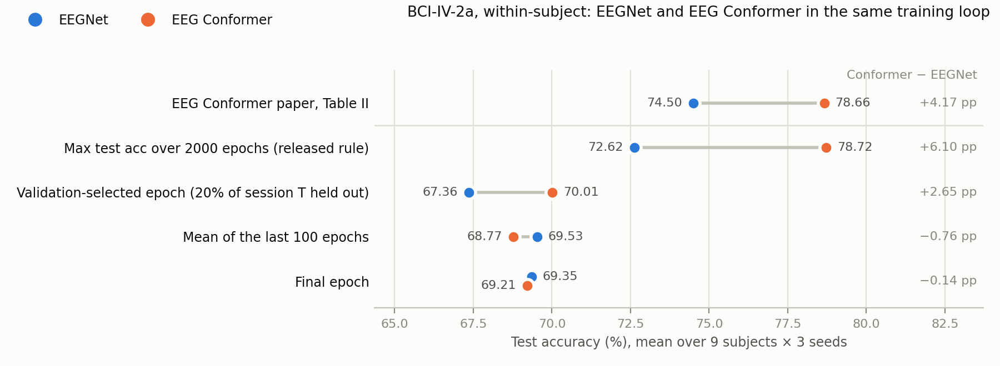

# EEGNet under EEG Conformer's training loop and epoch-selection rules (BCI IV 2a)

EEG Conformer's Table II reports 78.66% on BCI IV 2a against 74.50% for EEGNet. The EEG Conformer experiment
([bciciv2a-epoch-selection](../../../eeg-conformer/experiments/bciciv2a-epoch-selection)) showed that Conformer's
number is the maximum over 2000 per-epoch evaluations of the test session. The paper does not say how its EEGNet
number was obtained (no baseline code is released). This experiment asks:

> Does EEG Conformer's lead over EEGNet survive when both models are trained by the same loop and their reported
> epoch is chosen by the same rule?

It runs EEGNet ([braindecode](../../upstream) v1.8.1) through EEG Conformer's released training loop. The loop is
imported from the EEG Conformer experiment's `code/run_validation.py`, and only the model is swapped. Everything else
matches the committed Conformer runs: same preprocessed data, z-scoring, segmentation-and-recombination
augmentation, batch 72, Adam (lr 2e-4, β 0.5 / 0.999), 2000 epochs, seeds 2023–2025 and the two protocols.

| Tag | Training data | Reported epoch | Runs |
|---|---|---|---|
| **A** | all 288 trials of session T | read four ways from the per-epoch test curve: maximum (Conformer's released rule), last-100-epoch mean, final epoch, all-epoch mean | 9 subjects × 3 seeds = 27 |
| **B** | 80% of session T (20% held out) | epoch with the highest validation accuracy | 9 subjects × 3 seeds = 27 |

The two models' runs are paired. Protocol B's validation split comes from the session-T shuffle, which is drawn
from the seeded NumPy generator; building either model leaves that generator untouched (checked), so a given
(subject, seed) has the same validation trials for both models.

## Results

Each cell is the grand mean over 9 subjects × 3 seeds, with κ computed from the grand-mean accuracy (4 classes).
The EEG Conformer numbers are that experiment's committed runs. Conformer − EEGNet is the mean of the 9 per-subject
differences. p is from a two-sided Wilcoxon signed-rank test over the 9 subjects, the test the paper uses; for
the paper row it is recomputed from Table II's per-subject accuracies.

| Reported epoch | EEGNet, acc. % (κ) | EEG Conformer, acc. % (κ) | Conformer − EEGNet | Subjects where Conformer is higher | Wilcoxon p |
|---|---|---|---|---|---|
| Paper, Table II | 74.50 (0.6600) | 78.66 (0.7155) | +4.17 pp | 7 / 9 | 0.0497 |
| **A**: maximum over 2000 test evaluations (Conformer's released rule) | 72.62 (0.6349) | 78.72 (0.7162) | **+6.10 pp** | 9 / 9 | **0.0039** |
| **A**: mean of the last 100 epochs | 69.53 (0.5937) | 68.77 (0.5836) | −0.76 pp | 4 / 9 | 0.65 |
| **A**: final epoch | 69.35 (0.5914) | 69.21 (0.5895) | −0.14 pp | 4 / 9 | 1.00 |
| **B**: validation-selected epoch | 67.36 (0.5648) | 70.01 (0.6001) | +2.65 pp | 6 / 9 | 0.16 |



- **Conformer's significant lead over EEGNet exists only under the test-set maximum.** Under that rule the lead
  is larger than in the paper: +6.10 pp, on all 9 subjects, p = 0.0039. Read the same protocol A runs at the
  last-100-epoch mean or at the final epoch, and EEGNet is level with Conformer or slightly ahead (−0.76 and
  −0.14 pp; Conformer higher on 4 of 9 subjects).
- **With a validation split, Conformer is ahead by 2.65 pp, but not significantly** (6 of 9 subjects,
  p = 0.16). The lead comes from the validation selection itself. On the same protocol B runs, EEGNet's
  last-100-epoch mean is 1.07 pp above Conformer's (68.15 vs. 67.08). Choosing the epoch on the 58 validation
  trials then adds 2.94 pp to Conformer and takes 0.79 pp from EEGNet. EEGNet's validation accuracy has a
  plateau, not a peak: on average 23.3 epochs tie at its maximum (one trial is 1.72 pp), against 6.7 for
  Conformer, and the rule takes the first of them.
- **Why the maximum favours Conformer: its test accuracy moves about five times as much from epoch to
  epoch.** The SD of test accuracy over the last 100 epochs of a run is 5.52 pp for Conformer and 1.10 pp for
  EEGNet. The maximum of 2000 evaluations is therefore 9.95 pp above Conformer's last-100 mean, but only
  3.09 pp above EEGNet's.
- **Our EEGNet is 1.88 pp below Table II's EEGNet under the released rule** (72.62 vs. 74.50). Most of the
  shortfall is subjects 5 and 7 (−11.0 and −9.6 pp); subject 3 is 4.4 pp above. The paper does not say how
  its EEGNet number was produced, so this does not show which rule it used.
- **Caveats.** The loop's settings are Conformer's, not EEGNet's own (Adam lr 2e-4 with β1 0.5 here; the EEGNet
  paper uses Adam's defaults, lr 1e-3). EEGNet converges slowly in this loop: its test accuracy first comes
  within 1 pp of its last-100 mean at a median epoch of 535, against 72 for Conformer. If the untuned recipe
  costs either model, it is more likely EEGNet. Other caveats: 9 subjects and 3 seeds; four rules tested
  without multiple-comparison correction; and the protocol B runs train on 80% of session T, which costs
  1.4 pp (EEGNet) and 1.7 pp (Conformer) in last-100 mean against protocol A.

EEGNet per subject, mean ± SD over the 3 seeds (accuracy, %):

| Subject | Paper | A: max over test evaluations | A: last-100 mean | A: final epoch | B: validation-selected |
|---|---|---|---|---|---|
| 1 | 85.76 | 85.65 ± 4.02 | 84.09 ± 4.13 | 83.80 ± 4.88 | 83.33 ± 1.84 |
| 2 | 61.46 | 57.64 ± 0.35 | 54.44 ± 0.96 | 53.94 ± 1.78 | 52.20 ± 2.56 |
| 3 | 88.54 | 92.94 ± 0.53 | 90.07 ± 0.71 | 89.81 ± 0.53 | 89.24 ± 1.04 |
| 4 | 67.01 | 69.79 ± 1.59 | 67.12 ± 1.83 | 66.67 ± 1.51 | 60.19 ± 2.95 |
| 5 | 55.90 | 44.91 ± 2.61 | 41.11 ± 2.40 | 40.62 ± 2.76 | 41.90 ± 0.53 |
| 6 | 52.08 | 53.36 ± 2.21 | 49.91 ± 0.50 | 50.81 ± 0.53 | 47.11 ± 4.48 |
| 7 | 89.58 | 79.98 ± 2.31 | 75.77 ± 1.81 | 75.93 ± 3.61 | 72.22 ± 8.86 |
| 8 | 83.33 | 82.41 ± 0.87 | 78.73 ± 0.69 | 77.89 ± 3.03 | 77.89 ± 2.03 |
| 9 | 86.81 | 86.92 ± 1.12 | 84.50 ± 0.89 | 84.72 ± 1.39 | 82.18 ± 3.30 |
| **Avg** | **74.50** | **72.62** | **69.53** | **69.35** | **67.36** |

How much the reported number depends on the rule, and how much the test curve moves (pp per run, mean ± SD
over 27 runs):

| | EEGNet | EEG Conformer |
|---|---|---|
| max − last-100 mean (protocol A) | 3.09 ± 1.15 | 9.95 ± 3.37 |
| max − final epoch (protocol A) | 3.27 ± 1.56 | 9.50 ± 8.55 |
| max − validation-selected (protocol B, same run) | 4.00 ± 1.37 | 6.91 ± 4.56 |
| SD of test accuracy over the last 100 epochs (protocol A) | 1.10 ± 0.40 | 5.52 ± 1.70 |

Protocol B runs (80% of session T for training, 58 validation trials):

| | EEGNet | EEG Conformer |
|---|---|---|
| test accuracy, mean of the last 100 epochs | 68.15 | 67.08 |
| test accuracy at the validation-selected epoch | 67.36 | 70.01 |
| validation-selected − last-100 mean | −0.79 pp | +2.94 pp |
| median validation-selected epoch (0-based) | 1466 | 1096 |
| epochs tied at the maximum validation accuracy (mean per run) | 23.3 | 6.7 |

Where the maximum lands in protocol A (epochs 0-based, as `conformer.py` prints them):

| | EEGNet | EEG Conformer |
|---|---|---|
| median epoch of the maximum (range) | 1851 (620–1998) | 1427 (468–1996) |
| runs whose maximum comes after epoch 1000 | 85% | 78% |
| median first epoch within 1 pp of the last-100 mean | 535 | 72 |
| seconds per epoch | 0.732 (Quadro M6000) | 0.567 (A40) |

All numbers are in `results/results.txt` and `results/results.json`, and the headline rows are in
`results/summary.csv`.

## Paper vs. this reproduction

### What differs, and why

| | EEGNet paper (Lawhern et al. 2018) | EEG Conformer paper, EEGNet row | This experiment | Why |
|---|---|---|---|---|
| Implementation | Keras / TensorFlow (`arl-eegmodels`) | not stated | braindecode `EEGNet` v1.8.1 (PyTorch) | runs inside Conformer's PyTorch loop unchanged |
| Data | BCI IV 2a resampled to 128 Hz, [0.5, 2.5] s after the cue | not stated | Conformer's preprocessing: 250 Hz, [2, 6] s, 22 channels, Chebyshev-II 4–40 Hz, z-score | only the model may differ from the Conformer runs |
| Training | Adam with default settings, 500 epochs, the epoch with the lowest validation loss | not stated | Conformer's loop: Adam lr 2e-4, β 0.5 / 0.999, batch 72, S&R augmentation, 2000 epochs | same |
| Reported epoch | lowest validation loss | not stated | protocol A read-outs and protocol B, as for Conformer | the question of this experiment |
| Evaluation | within-subject: 4-fold block-wise cross-validation; the SMR results are shown only as figures | session T → session E | session T → session E | the protocol of the Table II comparison |

### Settings we had to choose

| Setting | Value | Why |
|---|---|---|
| Variant | EEGNet-8,2 (F1 = 8, D = 2, F2 = 16) | the larger of the paper's two variants (EEGNet-4,2 and -8,2), braindecode's default, and the variant in our CBraMod-pipeline runs |
| Temporal kernel | 64 samples (0.256 s at 250 Hz) | the EEGNet paper uses 32 samples at 128 Hz (0.25 s) for this dataset, "since the data were high-passed at 4Hz"; 64 is also braindecode's default |
| Dropout | 0.5 | the EEGNet paper's value for within-subject training (braindecode default: 0.25) |
| Classifier | dense layer with max norm 0.25 (`final_layer_with_constraint=True`) | EEGNet paper, Table 2; braindecode's default (a convolutional classifier without the constraint) is deprecated |
| Other layers | braindecode defaults: separable kernel 16, average pooling 4 and 8, depthwise max norm 1, batch-norm momentum 0.01, ε 1e-3 | the paper's values at 128 Hz, not rescaled to 250 Hz |
| Output | the logits feed Conformer's cross-entropy loss; `EEGNetForExP` returns them in place of Conformer's (features, logits) pair | the features are never used by the loop |

### Run configuration

`code/run_eegnet.py` → EEG Conformer experiment's `code/run_validation.py` (`--epochs 2000`, `--val-frac 0.0` for A
and `0.2` for B, seeds 2023 / 2024 / 2025) with `EEGNet(n_chans=22, n_outputs=4, n_times=1000, F1=8, D=2,
kernel_length=64, drop_prob=0.5, final_layer_with_constraint=True)`, 3,444 parameters.
`cudnn.deterministic = True` and `cudnn.benchmark = False`, as set by the imported loop. Environment: Python 3.11.17,
torch 2.6.0+cu124 (the EEG Conformer runs' version), braindecode 1.8.1 from `../../upstream`, numpy 2.4.6, scipy
1.17.1 (`env/setup_env.sh`, `env/pip_freeze.txt`). Hardware: mcl-server, one Quadro M6000 12 GB per run, 8 runs at a
time. The EEG Conformer runs used NVIDIA A40s on USC CARC. The 54 runs took 2 h 57 min on 2026-10-19 (median 21 min
per run in A and 25 min in B; up to 42 min, because the server's CPUs were shared with other users). One run,
B_s9_seed2024, failed in its first 12 seconds: another user was holding most of its GPU's memory, and the
out-of-memory error surfaced as an NVML assertion. It was re-run unchanged, with the same seed, on another GPU
(`logs/queue.log`; the failed attempt's console output is `logs/runs/B_s9_seed2024.attempt1-failed.txt`).

## Layout

```
code/run_eegnet.py       imports the EEG Conformer loop and swaps its model for braindecode's EEGNet
code/add_jobs.py         queues the 54 runs for tools/run_queue.py
code/analyze.py          every table in this README -> results/results.txt, results/results.json
code/export_summary.py   results/summary.csv (feeds the repo-wide RESULTS.md)
code/make_figure.py      results/fig_epoch_selection.png
env/                     setup_env.sh, pip_freeze.txt
results/curve_*.npz      per-epoch test / val / train accuracy for all 54 runs (same format as the Conformer curves)
logs/runs/<tag>_s<subject>_seed<seed>.txt   console output of each run (+ the failed first attempt of B_s9_seed2024)
logs/queue.log           start and end of every job, including the manual retry
```

## Reproducing

From the committed curves, with no GPU (numpy, scipy, matplotlib). `analyze.py` also reads the EEG Conformer
curves from `../../../eeg-conformer/experiments/bciciv2a-epoch-selection/results`:

```bash
mkdir -p results_rerun
python code/analyze.py results > results_rerun/results.txt
diff results_rerun/results.txt results/results.txt
python code/make_figure.py results
python code/export_summary.py results
```

Re-running the training on a Linux GPU server (21–25 min per run on a Quadro M6000, about 3 h for all 54 on 8 GPUs):

```bash
git clone --recurse-submodules https://github.com/woo0kim/eeg-analysis-methods-review
cd eeg-analysis-methods-review/methods/eegnet/experiments/bciciv2a-epoch-selection
bash env/setup_env.sh
../../../../datasets/download.sh bciciv2a
mkdir -p ~/repro-eegnet
~/miniforge3/envs/eegnet/bin/python ../../../eeg-conformer/experiments/bciciv2a-epoch-selection/code/preprocess_2a.py \
    --raw ${EEG_DATA_ROOT:-~/data}/bciciv2a/data_mat --out ~/repro-eegnet/data_proc
~/miniforge3/envs/eegnet/bin/python code/add_jobs.py
RUN_QUEUE_DIR=~/repro-eegnet/queue python ../../../../tools/run_queue.py 0 1 2 3 4 5 6 7
python code/analyze.py ~/repro-eegnet/results > results_rerun/results.txt
```

Paths come from `EEGNET_WORK` (`~/repro-eegnet`: data_proc, results, logs, queue) and `EEGNET_PY`
(`~/miniforge3/envs/eegnet/bin/python`). `run_eegnet.py` finds the Conformer loop through `EEGCONF_CODE`
(default: the EEG Conformer experiment's `code/` in this repository).
