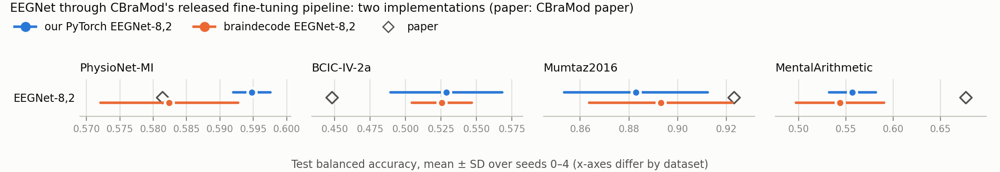

# EEGNet (braindecode) under CBraMod's splits

The CBraMod paper compares against EEGNet (Tables 3, 10, 12, 15), and CBraMod's
[finetune-public-datasets](../../../cbramod/experiments/finetune-public-datasets) re-ran that baseline through
CBraMod's released fine-tuning pipeline with our own PyTorch EEGNet-8,2 (`scripts/run_eegnet.py` there). This
experiment asks:

> Does braindecode's `EEGNet`, trained through the same pipeline, give the same numbers as our implementation?

`code/run_eegnet.py` keeps everything of CBraMod's released pipeline (`methods/cbramod/upstream`, commit `b9e9610`):
the dataset loaders and subject splits, the `Trainer` (loss, AdamW, cosine schedule, gradient clipping, label
smoothing, checkpoint on the best validation κ / AUROC, one test evaluation) and the `Evaluator`. Only the model is
braindecode's `EEGNet` ([braindecode](../../upstream) v1.8.1, the pinned submodule). With no `backbone` parameters, the
whole model trains at the `Trainer`'s head learning rate (5e-4), as our PyTorch EEGNet did. 4 datasets × seeds 0–4:
20 runs.

## Results

All 20 runs finished on 2026-10-22 (mean ± std over seeds 0–4; p from Welch's t-test). The two implementations have
the same number of parameters on every dataset (2,193–4,020).

| Dataset (CBraMod paper table) | Metric | Paper (EEGNet row) | Our PyTorch EEGNet | braindecode EEGNet | braindecode − PyTorch (p) | braindecode − paper (p) |
|---|---|---|---|---|---|---|
| PhysioNet-MI (T3) | balanced acc. | 0.5814 ± 0.0125 | 0.5948 ± 0.0028 | 0.5824 ± 0.0103 | −0.0124 (0.053) | +0.0010 (0.89) |
|  | Cohen's κ | 0.4468 ± 0.0199 | 0.4597 ± 0.0037 | 0.4431 ± 0.0138 | −0.0166 (0.053) | −0.0037 (0.74) |
|  | weighted F1 | 0.5796 ± 0.0115 | 0.5955 ± 0.0023 | 0.5837 ± 0.0110 | −0.0118 (0.074) | +0.0041 (0.58) |
| BCIC-IV-2a (T15) | balanced acc. | 0.4482 ± 0.0094 | 0.5288 ± 0.0394 | 0.5255 ± 0.0212 | −0.0033 (0.87) | +0.0773 (<0.001) |
|  | Cohen's κ | 0.2693 ± 0.0121 | 0.3718 ± 0.0525 | 0.3674 ± 0.0282 | −0.0044 (0.87) | +0.0981 (<0.001) |
|  | weighted F1 | 0.4226 ± 0.0108 | 0.5094 ± 0.0491 | 0.5141 ± 0.0275 | +0.0047 (0.86) | +0.0915 (<0.001) |
| Mumtaz2016 (T10) | balanced acc. | 0.9232 ± 0.0104 | 0.8828 ± 0.0295 | 0.8931 ± 0.0293 | +0.0103 (0.60) | −0.0302 (0.08) |
|  | AUC-PR | 0.9626 ± 0.0095 | 0.9596 ± 0.0096 | 0.9716 ± 0.0100 | +0.0121 (0.09) | +0.0090 (0.18) |
|  | AUROC | 0.9639 ± 0.0093 | 0.9540 ± 0.0073 | 0.9659 ± 0.0113 | +0.0119 (0.09) | +0.0020 (0.77) |
| MentalArithmetic (T12) | balanced acc. | 0.6770 ± 0.0116 | 0.5569 ± 0.0247 | 0.5437 ± 0.0467 | −0.0132 (0.60) | −0.1333 (0.002) |
|  | AUC-PR | 0.5763 ± 0.0102 | 0.6104 ± 0.1208 | 0.6076 ± 0.2308 | −0.0029 (0.98) | +0.0312 (0.78) |
|  | AUROC | 0.7321 ± 0.0108 | 0.7794 ± 0.0866 | 0.7880 ± 0.1492 | +0.0086 (0.91) | +0.0559 (0.45) |



- **The two implementations agree.** None of the 12 metrics differs significantly. The closest call is PhysioNet-MI,
  where braindecode's EEGNet is 0.012 lower (p = 0.053); its seed spread there is also larger (±0.0103 against
  ±0.0028).
- **Against the CBraMod paper's EEGNet rows, 8 of 12 metrics are within noise** (our PyTorch EEGNet: 6 of 12).
  braindecode's PhysioNet-MI numbers match the paper (0.5824 vs. 0.5814). As with our implementation, BCIC-IV-2a is
  far above the paper (+0.077 balanced accuracy) and MentalArithmetic balanced accuracy far below (−0.133).
- **The baseline findings of the CBraMod comparison do not depend on the EEGNet implementation.** braindecode's
  EEGNet is still the best model on BCIC-IV-2a, against CBraMod (0.5255 vs. 0.4571 released / 0.4703 braindecode)
  and LaBraM-Base (0.4477 released / 0.4375 braindecode), and it ties both on Mumtaz2016
  ([SUMMARY.md](../../../../SUMMARY.md)).

`results/results.txt` has every metric with per-seed values and the selected epochs.

## Paper vs. this reproduction

### What differs, and why

| | CBraMod paper, EEGNet rows | Our PyTorch EEGNet ([finetune-public-datasets](../../../cbramod/experiments/finetune-public-datasets)) | This experiment | Why |
|---|---|---|---|---|
| Implementation | BIOT's code, settings not reported | `scripts/run_eegnet.py` (PyTorch, written for that experiment) | braindecode 1.8.1 `EEGNet` | the question of this experiment |
| Architecture | – | EEGNet-8,2: temporal kernel 100 (0.5 s at 200 Hz), depthwise spatial, separable kernel 16, average pooling 4 and 8, dropout 0.25 | the same values | – |
| Max-norm constraints | – | none | depthwise spatial filter max norm 1; dense classifier max norm 0.25 | EEGNet paper (Lawhern et al. 2018, Table 2); braindecode's default for the depthwise filter, and `final_layer_with_constraint=True` for the classifier, as in the within-subject braindecode runs ([bciciv2a-epoch-selection](../bciciv2a-epoch-selection)) |
| Batch norm | – | PyTorch defaults (momentum 0.1, ε 1e-5) | braindecode defaults (momentum 0.01, ε 1e-3, the Keras values of the original code) | braindecode's implementation |
| Initialisation | – | PyTorch defaults (Kaiming uniform) | Glorot uniform, zero bias (`glorot_weight_zero_bias`, the Keras default of the original code) | braindecode's implementation |
| Pipeline, seeds, environment | – | CBraMod's released `Trainer`, seeds 0–4, Python 3.11.7, PyTorch 2.1.2 + CUDA 12.1 | the same, in the cloned env with braindecode added (`bd-cbramod`, shared with [CBraMod's braindecode experiment](../../../cbramod/experiments/braindecode-public-datasets)) | only the model may differ |

### Settings we had to choose

| Setting | Value | Why |
|---|---|---|
| Variant | EEGNet-8,2 (F1 = 8, D = 2, F2 = 16) | as our PyTorch runs and the within-subject braindecode runs |
| Temporal kernel | 100 samples (0.5 s at 200 Hz) | the EEGNet paper's 64 samples at 128 Hz, as in our PyTorch runs |
| Dropout | 0.25 | Lawhern et al.'s value for cross-subject training; braindecode's default; our PyTorch runs' value |
| Classifier | dense layer with max norm 0.25 (`final_layer_with_constraint=True`) | EEGNet paper, Table 2; braindecode's default classifier (a convolution without the constraint) is deprecated |
| Other layers | braindecode defaults | – |

### Run configuration

CBraMod's `finetune_main.py` defaults (= its paper's Table 6), as for our PyTorch EEGNet: 50 epochs, batch 64, AdamW
(β 0.9 / 0.999, ε 1e-8), lr 5e-4 for the whole model (`multi_lr` head rate; no `backbone` parameters), weight decay
5e-2, cosine annealing to 1e-6, gradient clipping 1, label smoothing 0.1 (multi-class), checkpoint on the best
validation κ (multi-class) or AUROC (binary). Environment: `bd-cbramod` (`env/setup_env.sh`, `env/pip_freeze.txt`).
Hardware: mcl-server, one Quadro M6000 12 GB per run. The 20 runs took place on 2026-10-22, 06:10–06:33 UTC; per run:
PhysioNet-MI 13 min, Mumtaz2016 4.3 min, BCIC-IV-2a 2.5 min, MentalArithmetic 1.3 min. The queue ran with the NVML
library workaround described in
[braindecode-bciciv2a](../../../eeg-conformer/experiments/braindecode-bciciv2a#run-configuration); it does not touch
the computation.

## Layout

```
code/run_eegnet.py       braindecode's EEGNet through CBraMod's released Trainer and loaders
code/add_jobs.py         queues the runs for tools/run_queue.py
code/collect.py          parses the run logs -> results/results.txt, results/results.json (with our PyTorch EEGNet runs)
code/export_summary.py   results/results.json -> results/summary.csv (feeds the repo-wide RESULTS.md)
code/make_figure.py      results/fig_braindecode_vs_pytorch.png
env/                     setup_env.sh, pip_freeze.txt
logs/runs/<dataset>__eegnet__s<seed>/log.txt   full log of each run (CLI arguments on line 1)
logs/queue.log           start and end of every job
```

## Reproducing

From the committed logs, with no GPU (numpy, scipy, matplotlib):

```bash
mkdir -p results_rerun
python code/collect.py logs/runs results_rerun > results_rerun/results.txt
diff results_rerun/results.txt results/results.txt
python code/export_summary.py results
python code/make_figure.py results
```

Re-running the training on a Linux GPU server, after the CBraMod data have been preprocessed (step 2 of
[CBraMod's finetune-public-datasets](../../../cbramod/experiments/finetune-public-datasets#reproducing)):

```bash
git clone --recurse-submodules https://github.com/woo0kim/eeg-analysis-methods-review
cd eeg-analysis-methods-review/methods/eegnet/experiments/braindecode-cbramod-splits
bash env/setup_env.sh
for ds in PhysioNet-MI BCIC-IV-2a Mumtaz2016 MentalArithmetic; do python code/add_jobs.py $ds 0 1 2 3 4; done
RUN_QUEUE_DIR=~/repro-braindecode/queue python ../../../../tools/run_queue.py 0 1 2 3 4 5 6 7
python code/collect.py ~/repro-braindecode/eegnet/runs results_rerun > results_rerun/results.txt
```

Paths come from `EEG_DATA_ROOT` (`~/data`), `BD_EEGNET_WORK` (`~/repro-braindecode/eegnet`), `BD_QUEUE`
(`~/repro-braindecode/queue`), `BD_CBRAMOD_PY` (`~/miniforge3/envs/bd-cbramod/bin/python`) and `CBRAMOD_SRC`
(`methods/cbramod/upstream`).
