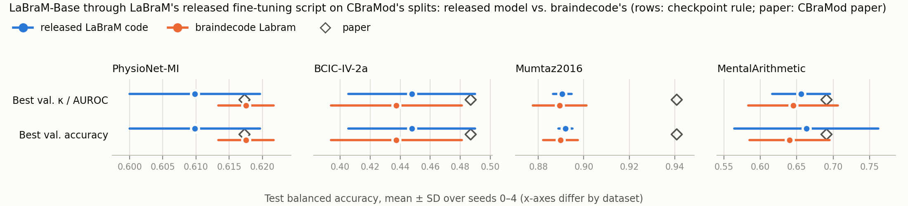

# LaBraM-Base as implemented in braindecode, under CBraMod's splits

[finetune-cbramod-splits](../finetune-cbramod-splits) fine-tuned LaBraM-Base with its released code and weights on
CBraMod's data, splits, seeds and scoring. This experiment asks:

> Does braindecode's `Labram`, with braindecode's pre-trained weights and fine-tuned by the same released script,
> reproduce those numbers?

`code/run_braindecode.py` imports the released-code experiment's `code/run_labram.py`, so LaBraM's released
`run_class_finetuning.py` runs with the same two hooks (CBraMod's LMDB data and subject splits; the validation and test
probabilities of every epoch saved to `preds.npz`) and the same recipe (LaBraM README's TUAB command on one GPU, see
`code/add_jobs.py`). Only `get_models()` is replaced: it builds braindecode's `Labram` ([braindecode](../../../eegnet/upstream)
v1.8.1) with the settings the released `get_models()` passes to LaBraM's own model, and loads braindecode's
pre-trained weights. The runs are scored by `code/collect.py` exactly as the released-code runs: CBraMod's checkpoint
rule (best validation κ / AUROC) and metric formulas, plus LaBraM's own rule (best validation accuracy). 4 datasets ×
seeds 0–4: 20 runs.

## Is braindecode's Labram the released model?

`code/check_equivalence.py` (output: `results/equivalence.txt`):

- **The weights are the released weights.** braindecode's Hugging Face file (`braindecode/labram-pretrained`, revision
  `0563b6c`) holds 221 tensors: the `student.` tensors of the released `checkpoints/labram-base.pth`, all identical,
  minus the three used only in pre-training (`mask_token`, `lm_head`). Five names differ: `pos_embed` →
  `position_embedding`, `time_embed` → `temporal_embedding`, `patch_embed.*` → `patch_embed.temporal_conv.*`, and the
  MLP's `fc1` / `fc2` → `0` / `2`.
- **The channel mapping is the released one.** For every dataset, braindecode maps the channel names to the same
  rows of the position embedding as LaBraM's `utils.get_input_chans()`.
- **The model is the released model.** Built with the recipe's settings (mean pooling, drop path 0.1, layer scale 0.1,
  no qkv bias, no relative position bias) and with the released model's freshly initialised head and `fc_norm` copied
  in, braindecode's model gives logits identical to the released model's (max |difference| 0 in float64) on all four
  datasets. Parameters: 5,818,540 (4-s windows) and 5,818,137 (5-s windows) against the released model's 5,820,740
  and 5,820,137; the difference is unused rows of the time embedding (braindecode sizes it by the window, the released
  model always keeps 16 rows).

Three adapters in `run_braindecode.py` make braindecode's model fit LaBraM's training code without changing the
computation:

| Adapter | Why it is needed | Check |
|---|---|---|
| `forward(x, input_chans)` reshapes LaBraM's (batch, channels, patches, 200) to (batch, channels, time) and passes the channel names | braindecode's API | logits identical (above) |
| `no_weight_decay()` returns `{position_embedding, cls_token, temporal_embedding}` | LaBraM's optimizer calls it; braindecode's `Labram` has no such method. These are braindecode's names for LaBraM's `{pos_embed, cls_token, time_embed}` | parameter groups below |
| layer-wise learning-rate decay looks `position_embedding` / `temporal_embedding` up under LaBraM's names | LaBraM's `get_num_layer_for_vit()` assigns layers by name; without the translation the position embedding would train at the top layer's rate (1.0×) instead of layer 0's (0.0037×) | parameter groups below |

The parameter groups printed by a braindecode run and by a released-code run (`logs/runs/*/stdout.txt`, Mumtaz2016
seed 0) were compared after translating the names: all 223 trainable tensors get the same weight decay and the same
learning-rate scale.

Pre-trained weights for 4- and 5-s windows cannot be loaded with braindecode's `from_pretrained()`: braindecode sizes
`temporal_embedding` by `n_times` (the file has 16 rows; a 4-s model has 5), and loading raises a size mismatch. The
runs therefore download the same file and keep the first rows of `temporal_embedding`. Both implementations use rows
0 … patches − 1 only.

## Results

All 20 runs finished on 2026-10-22 (mean ± std over seeds 0–4; p from Welch's t-test, as in the released-code
experiment). Headline rule: CBraMod's checkpoint rule (best validation κ / AUROC).

| Dataset (CBraMod paper table) | Metric | Paper | Released code | braindecode | braindecode − released (p) | braindecode − paper (p) |
|---|---|---|---|---|---|---|
| PhysioNet-MI (T3) | balanced acc. | 0.6173 ± 0.0122 | 0.6098 ± 0.0098 | 0.6175 ± 0.0042 | +0.0077 (0.16) | +0.0002 (0.97) |
|  | Cohen's κ | 0.4912 ± 0.0192 | 0.4797 ± 0.0131 | 0.4899 ± 0.0056 | +0.0102 (0.16) | −0.0013 (0.89) |
|  | weighted F1 | 0.6177 ± 0.0141 | 0.6129 ± 0.0095 | 0.6212 ± 0.0034 | +0.0084 (0.12) | +0.0035 (0.61) |
| BCIC-IV-2a (T15) | balanced acc. | 0.4869 ± 0.0085 | 0.4477 ± 0.0421 | 0.4375 ± 0.0435 | −0.0102 (0.71) | −0.0494 (0.06) |
|  | Cohen's κ | 0.3159 ± 0.0154 | 0.2637 ± 0.0562 | 0.2500 ± 0.0580 | −0.0137 (0.71) | −0.0659 (0.06) |
|  | weighted F1 | 0.4758 ± 0.0103 | 0.3911 ± 0.0534 | 0.3812 ± 0.0538 | −0.0099 (0.78) | −0.0946 (0.02) |
| Mumtaz2016 (T10) | balanced acc. | 0.9409 ± 0.0079 | 0.8905 ± 0.0041 | 0.8894 ± 0.0119 | −0.0012 (0.84) | −0.0515 (<0.001) |
|  | AUC-PR | 0.9798 ± 0.0093 | 0.9711 ± 0.0089 | 0.9710 ± 0.0010 | −0.0001 (0.98) | −0.0088 (0.10) |
|  | AUROC | 0.9782 ± 0.0057 | 0.9664 ± 0.0166 | 0.9690 ± 0.0018 | +0.0026 (0.74) | −0.0092 (0.02) |
| MentalArithmetic (T12) | balanced acc. | 0.6909 ± 0.0125 | 0.6562 ± 0.0397 | 0.6451 ± 0.0613 | −0.0111 (0.74) | −0.0458 (0.17) |
|  | AUC-PR | 0.5999 ± 0.0155 | 0.6146 ± 0.0793 | 0.5618 ± 0.0614 | −0.0528 (0.28) | −0.0381 (0.24) |
|  | AUROC | 0.7721 ± 0.0093 | 0.7791 ± 0.0608 | 0.7557 ± 0.0618 | −0.0234 (0.56) | −0.0164 (0.59) |



- **braindecode's Labram reproduces the released-code runs.** None of the 12 metrics differs significantly
  (p ≥ 0.12), under either checkpoint rule (LaBraM's own best-validation-accuracy rule: also all p ≥ 0.12). The
  differences go both ways: braindecode is ahead on PhysioNet-MI (+0.008 balanced accuracy), behind on the other
  three by 0.001–0.011. This is what the equivalence check predicts: same weights, same forward pass, same training
  code, so the two sets of runs differ only by random draws (initialisation of the head, data order, drop path),
  `cudnn.benchmark` and the PyTorch version (2.1.2 here, 2.0.1 there).
- **Against the CBraMod paper's LaBraM-Base numbers, 9 of 12 metrics are within noise** (released code: 10 of 12).
  PhysioNet-MI matches to the third decimal (0.6175 vs. 0.6173). The exceptions are the same kind as for the released
  code: Mumtaz2016 balanced accuracy (−0.052, the data-pipeline shortfall every model shows) and BCIC-IV-2a weighted
  F1 (−0.095), plus Mumtaz2016 AUROC (−0.009, p = 0.02).
- **The seed spread is that of the released code**, e.g. BCIC-IV-2a ±0.0435 against ±0.0421 (the paper reports
  ±0.0085).
- **With both foundation models run through braindecode, CBraMod no longer leads on PhysioNet-MI.** braindecode's
  CBraMod ([braindecode-public-datasets](../../../cbramod/experiments/braindecode-public-datasets)) reaches 0.6068 on
  PhysioNet-MI against 0.6175 here (CBraMod − LaBraM = −0.011, p = 0.13; released code: +0.017, p = 0.015), because
  braindecode's CBraMod head is weaker there. On the other three datasets the two do not differ either (p ≥ 0.17).

`results/results.txt` has every metric with per-seed values and the selected epochs of both implementations.

One run, `Mumtaz2016__labram__s4`, finished all 50 epochs, wrote its last log line (`Training time 0:17:26`) and its
predictions, and then exited with a segmentation fault (return code 139, `logs/queue.log` lists it as FAILED). Its
outputs are complete (50 epochs of validation and test predictions and 50 log lines, as for the other runs), so it is
used as is; it was not re-run.

## Paper vs. this reproduction

### What differs, and why

| | Released-code runs ([finetune-cbramod-splits](../finetune-cbramod-splits)) | This experiment | Why |
|---|---|---|---|
| Model code | `modeling_finetune.py` (`labram_base_patch200_200`, timm) | braindecode 1.8.1 `Labram` with the same settings | the question of this experiment |
| Pre-trained weights | `checkpoints/labram-base.pth`, loaded by the released `--finetune` code | `braindecode/labram-pretrained` @ `0563b6c`, identical tensors, loaded by `run_braindecode.py`; `temporal_embedding` cut to the window | braindecode's own distribution; `from_pretrained()` cannot load it for these windows |
| Optimizer groups | `no_weight_decay()`, layer decay by name | same values through the adapters above | identical training |
| Script, recipe, data, channels, scoring | `run_class_finetuning.py` + `run_labram.py` hooks | the same, imported | only the model may differ |
| PyTorch | 2.0.1 + CUDA 11.8 | 2.1.2 + CUDA 11.8 | braindecode 1.8.1 declares `torch>=2.0` but imports `torch.nn.utils.parametrizations.weight_norm` (PyTorch ≥ 2.1) when `braindecode.models` is imported |
| Other packages | `labram` env | that env cloned, plus braindecode, huggingface_hub and safetensors; installing braindecode raised mne (1.4.2 → 1.12.1) and pandas (1.5.3 → 3.0.6). The fine-tuning path does not use mne; LaBraM's `utils.py` imports pandas without using it, and PyHealth uses it only for calibration metrics, which LaBraM does not request | braindecode's requirements |

For the differences between the CBraMod paper's LaBraM runs, LaBraM's released code and our use of it (input scale,
channel names, checkpoint rule, batch size, one GPU), see [finetune-cbramod-splits](../finetune-cbramod-splits#paper-vs-this-reproduction);
they apply here unchanged.

### Settings we had to choose

| Setting | Value | Why |
|---|---|---|
| braindecode arguments | `n_times`, `n_chans`, `n_outputs` of each dataset; `drop_prob`, `attn_drop_prob`, `drop_path_prob`, `use_mean_pooling`, `init_scale`, `use_abs_pos_emb`, `init_values`, `qkv_bias` from the recipe's command line, as the released `get_models()` passes them; everything else braindecode's default (which matches LaBraM-Base: 12 layers, 10 heads, qk-LayerNorm with ε 1e-6) | the same model a released-code run builds |
| Channel names | the released-code experiment's `CHANNELS` (MentalArithmetic without `EEG A2-A1`) | same input |

### Run configuration

The recipe of the released-code runs: `--model labram_base_patch200_200 --weight_decay 0.05 --batch_size 64 --lr 5e-4
--update_freq 1 --warmup_epochs 5 --epochs 50 --layer_decay 0.65 --drop_path 0.1 --disable_rel_pos_bias --abs_pos_emb
--disable_qkv_bias --no_save_ckpt`, seeds 0–4, one GPU launched as a one-process distributed job, mixed precision,
`cudnn.benchmark = True` (so re-runs are not bit-identical). Environment: Python 3.11.16, PyTorch 2.1.2 + CUDA 11.8,
timm 0.4.12, PyHealth 1.1.4, numpy 1.26.4, lmdb 1.4.1, braindecode 1.8.1 (`env/setup_env.sh`, `env/pip_freeze.txt`).
Hardware: mcl-server, one Quadro M6000 12 GB per run. The 20 runs took place on 2026-10-22, 02:53–06:31 UTC, sharing the
8 GPUs with the other braindecode experiments' queue; per run: PhysioNet-MI 67 min, Mumtaz2016 17.5 min, BCIC-IV-2a 12
min, MentalArithmetic 5.4 min. The queue ran with the NVML library workaround described in
[braindecode-bciciv2a](../../../eeg-conformer/experiments/braindecode-bciciv2a#run-configuration); it does not touch
the computation.

## Layout

```
code/run_braindecode.py    braindecode's Labram inside LaBraM's released run_class_finetuning.py (with run_labram.py's hooks)
code/check_equivalence.py  weights, channel mapping and logits vs. the released model -> results/equivalence.txt
code/add_jobs.py           queues the runs for tools/run_queue.py (recipe and launch variables)
code/collect.py            scores every run as the released-code runs are scored -> results/results.txt, results.json
code/export_summary.py     results/results.json -> results/summary.csv (feeds the repo-wide RESULTS.md)
code/make_figure.py        results/fig_braindecode_vs_released.png
env/                       setup_env.sh, pip_freeze.txt
logs/runs/<dataset>__labram__s<seed>/
    preds.npz              validation and test probabilities for each of the 50 epochs, with labels
    log.txt                LaBraM's per-epoch JSON log (its own metrics)
    stdout.txt             full console output
logs/queue.log             start and end of every job
```

## Reproducing

From the committed predictions, with no GPU (numpy, scipy, scikit-learn; matplotlib for the figure):

```bash
mkdir -p results_rerun
python code/collect.py logs/runs results_rerun > results_rerun/results.txt
diff results_rerun/results.txt results/results.txt
python code/export_summary.py results
python code/make_figure.py results
```

Re-running the training on a Linux GPU server, after the CBraMod data have been preprocessed (step 2 of
[CBraMod's finetune-public-datasets](../../../cbramod/experiments/finetune-public-datasets#reproducing)):

```bash
git clone --recurse-submodules https://github.com/woo0kim/eeg-analysis-methods-review
cd eeg-analysis-methods-review/methods/labram/experiments/braindecode-cbramod-splits
bash env/setup_env.sh        # clones the "labram" env of the released-code experiment
for ds in PhysioNet-MI Mumtaz2016 BCIC-IV-2a MentalArithmetic; do python code/add_jobs.py $ds 0 1 2 3 4; done
RUN_QUEUE_DIR=~/repro-braindecode/queue python ../../../../tools/run_queue.py 0 1 2 3 4 5 6 7
python code/collect.py ~/repro-braindecode/labram/runs results_rerun > results_rerun/results.txt
```

Paths come from `EEG_DATA_ROOT` (`~/data`), `BD_LABRAM_WORK` (`~/repro-braindecode/labram`), `BD_QUEUE`
(`~/repro-braindecode/queue`), `LABRAM_SRC` (`../../upstream`) and `BD_LABRAM_PY`
(`~/miniforge3/envs/bd-labram/bin/python`). The pre-trained weights are downloaded from the Hugging Face Hub on
first use.
